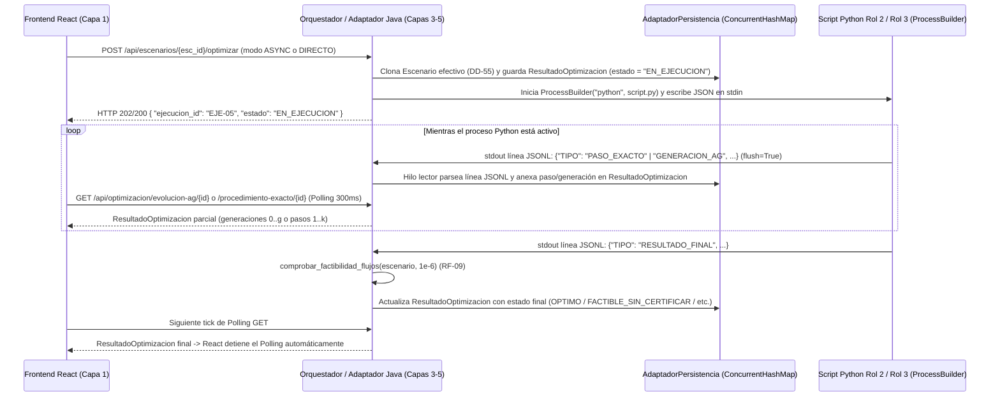

# PLAN MAESTRO DE ESPECIFICACIÓN E IMPLEMENTACIÓN — ECORESIDUOS DEL LLANO S.A.S.

> **Rol Emisor**: Arquitecto de Software Principal (Especialista en Arquitectura Hexagonal / Ports & Adapters y Clean Architecture).  
> **Agente Ejecutor Destinatario**: **Gemini 3.8 High**.  
> **Fuentes de Verdad Cruzadas**:
> - `docs/HUs y RNF/` (`HU-01` a `HU-19`, `RF-01` a `RF-34`, `RNF-01` a `RNF-06`, Diccionario de Datos `DD-01` a `DD-81` y Lectura de Negocio).
> - `docs/diagramas/DC/` (`DC-HU01.drawio` a `DC-HU19.drawio`) y `docs/diagramas/DS/` (`DS-HU01.drawio` a `DS-HU19.drawio`).
> - `mockups/` (`index.html` y `hu_01_*.html` a `hu_19_*.html`).

---

## 0. DECISIONES ARQUITECTÓNICAS CONSOLIDADAS (RESOLUCIÓN DE CONSULTAS 1A–5A)

1. **Semilla Oficial del Caso de Referencia (`ESC-01`) — Opción 1A**:
   - `AdaptadorPersistencia.cargar_datos_semilla()` precargará como escenario base `ESC-01` (*"Caso de referencia"*) los datos exactos de `hu_01..hu_06` y `hu_19`:
     - **10 Empresas Generadoras (`EMP-01` a `EMP-10`)** con ofertas `[25.0, 15.0, 18.0, 12.0, 8.0, 6.0, 10.0, 11.0, 5.0, 5.0]` (`oferta_total_t = 115.0 t/semana`).
     - **4 Plantas Procesadoras (`PLA-01` a `PLA-04`)** con capacidades máximas `[45.0, 25.0, 35.0, 30.0]` (`capacidad_total_t = 135.0 t/semana`).
     - **Matriz de Distancias Viales (`10 x 4`)** de `hu_05_distancias_viales.html` y tarifa base de `300.0 COP/(t·km)` de `hu_06_costos_transporte.html`, con la conexión `EMP-10 -> PLA-03` marcada como no disponible (`distancia_km = null`, `costo_unitario_t = null`, `estado_consulta = "sin_ruta"`, `compatible = false`, `activa = false`).
     - **Costo Total Óptimo Exacto ($Z^*$)**: **`997500.0 COP`** (`$ 997.500 COP`, con solución inicial de Vogel de `$ 1.052.550 COP` y asignación final: `EMP-01->PLA-01: 25t`, `EMP-02->PLA-03: 15t`, `EMP-03->PLA-02: 18t`, `EMP-04->PLA-03: 12t`, `EMP-05->PLA-03: 8t`, `EMP-06->PLA-01: 5t`, `EMP-06->PLA-02: 1t`, `EMP-07->PLA-01: 10t`, `EMP-08->PLA-04: 11t`, `EMP-09->PLA-01: 5t`, `EMP-10->PLA-04: 5t`).
   - Adicionalmente, se precargará el escenario inviable de prueba `ESC-04` (*"Escenario con exceso de oferta"*, `oferta_total_t = 120.0 t/semana`, `capacidad_total_t = 100.0 t/semana`, `aviso_capacidad = "Capacidad superada por la oferta"`) para verificación inmediata de `HU-08` y `HU-19`.

2. **Motor Exacto Híbrido (Rol 2) y Etapas `DD-73` — Opción 2A**:
   - El motor Python de **Rol 2** (`solver_exacto.py`) implementa la trazabilidad pedagógica completa (**Método de Aproximación de Vogel - VAM** + **Método de Distribución Modificada - MODI**) empaquetada dentro de las 4 etapas normativas de `DD-73` (`PREPARACION`, `FORMULACION`, `RESOLUCION`, `VALIDACION`), y además resuelve el programa lineal mediante **Simplex / HiGHS (`scipy.optimize.linprog` / `PuLP`)** para certificar el estado `OPTIMO` / `INFACTIBLE_CERTIFICADO` y extraer con precisión numérica los precios sombra (`PrecioSombraDual`) y rangos de optimalidad (`HU-14` y `HU-15`).

3. **Responsabilidad de Consulta Vial OSRM (`HU-01`, `HU-02`, `HU-05`) — Opción 3A**:
   - `OrquestadorOptimizacion.consultar_recorridos_viales_osrm()` en el **Backend Java** realiza la petición HTTP a `https://router.project-osrm.org/route/v1/driving/{lonO},{latO};{lonD},{latD}?overview=full&geometries=geojson` (con timeout y manejo de errores/fallback) para actualizar `distancia_km` (metros / 1000.0), `geometria` (`[[lon, lat], ...]`), `fuente_distancia = "OSRM (provisional)"` y `estado_consulta` (`"calculada"`, `"sin_ruta"`, `"error"`, `"pendiente"`). El **Frontend React** consume la API del backend y dibuja la polilínea en Leaflet (`react-leaflet`) invirtiendo `[lon, lat]` a `[lat, lon]` según `DD-80`.

4. **Escala Numérica de Tasas del AG (`DD-38`, `DD-39`) — Opción 4A**:
   - En la interfaz de usuario (`PanelHiperparametrosAG`), los campos de `tasa_cruce` y `tasa_mutacion` permiten ingreso en porcentaje `[0, 100]` (ej. `80 %` y `5 %`) o proporción `[0.0, 1.0]`. `ValidadorContratosEntrada.validar_hiperparametros_ag()` acepta ambos rangos (`[0.0, 100.0]`) y normaliza automáticamente cualquier valor `> 1.0` dividiéndolo entre `100.0` antes de invocar a `AdaptadorGenetico` y al script Python de **Rol 3** (además, el script Python aplica la misma salvaguarda `if tasa > 1.0: tasa /= 100.0`).

5. **Enrutamiento y Navegación de las 19 Vistas (`HU-01` a `HU-19`) — Opción 5A**:
   - La aplicación React expone las **19 rutas individuales** (`/hu-01` a `/hu-19`) más el portal índice (`/`) con acceso directo tanto en el Sidebar lateral como en las tarjetas del Hub principal.

---

## 1. ARQUITECTURA DEL MONOREPO Y ESTRUCTURA DE CARPETAS

El sistema se organiza como un **Monorepo Hexagonal en 5 Capas** con separación estricta entre el núcleo de dominio en Java 21 puro, los casos de uso de aplicación, los controladores REST en Spring Boot 3, los motores matemáticos/metaheurísticos en Python 3 y el cliente web en React + Vite + Tailwind CSS + Leaflet.

```mermaid
flowchart TD
    subgraph Capa1["Capa 1 — Presentación Web (React 18 + Vite + Tailwind + Leaflet)"]
        VPD["VistaParametrizacionDinamica (HU-01..HU-07)"]
        PHAG["PanelHiperparametrosAG (HU-16..HU-18)"]
        SE["SimuladorEscenarios (HU-10..HU-13)"]
        DAV["DashboardAnaliticoVisualizador (HU-08..HU-09, HU-14..HU-19)"]
    end

    subgraph Capa2["Capa 2 — Exposición y Controladores Web (Java 21 + Spring Boot 3)"]
        CPH["ControladorPeticionesHTTP"]
        VCE["ValidadorContratosEntrada"]
    end

    subgraph Capa3["Capa 3 — Aplicación / Casos de Uso (Java 21)"]
        OO["OrquestadorOptimizacion"]
        MAS["MotorAnalisisSensibilidad"]
        MCR["MotorComparacionRendimiento"]
    end

    subgraph Capa4["Capa 4 — Núcleo de Dominio y Puertos (Java 21 Puro)"]
        DOM["NodoRed, Empresa, Planta, NodoPaso, Ruta, Escenario,\nConfiguracionAG, PerturbacionSensibilidad, PrecioSombraDual,\nRegistroGeneracionAG, PasoMetodoExacto, ResultadoOptimizacion, ReporteComparativo"]
        IPO["<<interface>> IPuertoOptimizador"]
        IPRE["<<interface>> IPuertoRepositorioEscenarios"]
    end

    subgraph Capa5["Capa 5 — Infraestructura y Cómputo (Adaptadores Java 21 + Motores Python 3)"]
        AP["AdaptadorPersistencia (ConcurrentHashMap en sesión)"]
        ASE["AdaptadorSolucionadorExacto (ProcessBuilder + JSONL)"]
        AG["AdaptadorGenetico (ProcessBuilder + JSONL)"]
        PY2["python-engines/exact_solver/solver_exacto.py (Rol 2)"]
        PY3["python-engines/genetic_solver/solver_genetico.py (Rol 3)"]
        OSRM["Proveedor Vial Externo OSRM (driving)"]
    end

    Capa1 <-->|"JSON REST + Polling HTTP (300-500ms)"| CPH
    CPH --> VCE
    CPH --> OO
    CPH --> MAS
    MAS --> OO
    MAS --> MCR
    OO --> MCR
    OO --> DOM
    OO --> IPO
    OO --> IPRE
    OO -->|"HTTP GET route/v1/driving"| OSRM
    IPRE <|.. AP
    IPO <|.. ASE
    IPO <|.. AG
    ASE <-->|"stdin JSON / stdout JSONL"| PY2
    AG <-->|"stdin JSON / stdout JSONL"| PY3
```

### Estructura de Directorios del Monorepo

```text
proyecto final/
├── backend/                                      # Proyecto Maven Java 21 + Spring Boot 3.3.x
│   ├── pom.xml
│   └── src/
│       ├── main/
│       │   ├── java/com/ecoresiduos/llano/
│       │   │   ├── EcoResiduosApplication.java
│       │   │   ├── config/
│       │   │   │   ├── CorsConfig.java           # Habilita CORS para Vite (http://localhost:5173)
│       │   │   │   └── UseCaseBeansConfig.java   # Inyección de dependencias de Capas 3, 4 y 5
│       │   │   ├── exposition/                   # CAPA 2 — Exposición y Validación
│       │   │   │   ├── ControladorPeticionesHTTP.java
│       │   │   │   ├── ValidadorContratosEntrada.java
│       │   │   │   └── GlobalExceptionHandler.java
│       │   │   ├── application/                  # CAPA 3 — Casos de Uso
│       │   │   │   ├── OrquestadorOptimizacion.java
│       │   │   │   ├── MotorAnalisisSensibilidad.java
│       │   │   │   └── MotorComparacionRendimiento.java
│       │   │   ├── domain/                       # CAPA 4 — Núcleo de Dominio Puro (Cero frameworks)
│       │   │   │   ├── model/
│       │   │   │   │   ├── NodoRed.java
│       │   │   │   │   ├── Empresa.java
│       │   │   │   │   ├── Planta.java
│       │   │   │   │   ├── NodoPaso.java
│       │   │   │   │   ├── Ruta.java
│       │   │   │   │   ├── Escenario.java
│       │   │   │   │   ├── ConfiguracionAG.java
│       │   │   │   │   ├── PerturbacionSensibilidad.java
│       │   │   │   │   ├── PrecioSombraDual.java
│       │   │   │   │   ├── RegistroGeneracionAG.java
│       │   │   │   │   ├── PasoMetodoExacto.java
│       │   │   │   │   ├── ResultadoOptimizacion.java
│       │   │   │   │   └── ReporteComparativo.java
│       │   │   │   └── port/
│       │   │   │       ├── IPuertoOptimizador.java
│       │   │   │       └── IPuertoRepositorioEscenarios.java
│       │   │   └── infrastructure/               # CAPA 5 — Adaptadores de Infraestructura
│       │   │       ├── persistence/
│       │   │       │   └── AdaptadorPersistencia.java
│       │   │       └── optimizer/
│       │   │           ├── AdaptadorSolucionadorExacto.java
│       │   │           ├── AdaptadorGenetico.java
│       │   │           └── PythonProcessRunner.java
│       │   └── resources/
│       │       └── application.yml               # Puerto 8080, rutas a python-engines y timeout OSRM
│       └── test/
│           └── java/com/ecoresiduos/llano/       # Tests unitarios y de integración por fase
├── python-engines/                               # CAPA 5 — Motores Matemático (Rol 2) y Genético (Rol 3)
│   ├── requirements.txt                          # numpy>=1.26.0, scipy>=1.12.0
│   ├── common/
│   │   ├── __init__.py
│   │   └── jsonl_protocol.py                     # Helpers para emitir eventos JSONL con flush=True
│   ├── exact_solver/                             # ROL 2 — Modelo Lineal + Vogel + MODI + Duales HiGHS
│   │   ├── __init__.py
│   │   └── solver_exacto.py                      # Punto de entrada CLI invocado por AdaptadorSolucionadorExacto
│   └── genetic_solver/                           # ROL 3 — AG por Permutación de Prioridades (OX + Swap)
│       ├── __init__.py
│       └── solver_genetico.py                    # Punto de entrada CLI invocado por AdaptadorGenetico
├── frontend/                                     # CAPA 1 — React 18 + Vite + Tailwind CSS + Leaflet
│   ├── package.json
│   ├── vite.config.js
│   ├── tailwind.config.js
│   ├── index.html
│   └── src/
│       ├── main.jsx
│       ├── App.jsx                               # Router con "/" y "/hu-01" .. "/hu-19"
│       ├── api/
│       │   └── client.js                         # Cliente HTTP REST + Hook de Polling (300-500 ms)
│       ├── context/
│       │   └── SessionContext.jsx                # Estado global de escenario_activo_id y ejecucion_activa_id
│       ├── components/
│       │   ├── layout/
│       │   │   ├── SidebarNavegacion.jsx         # Sidebar idéntico a mockups con las 19 vistas
│       │   │   └── HeaderVista.jsx
│       │   ├── classes/                          # Clases lógicas de Capa 1 (DC-HU01..DC-HU19)
│       │   │   ├── VistaParametrizacionDinamica.js
│       │   │   ├── PanelHiperparametrosAG.js
│       │   │   ├── SimuladorEscenarios.js
│       │   │   └── DashboardAnaliticoVisualizador.js
│       │   └── shared/
│       │       ├── MapaLeafletOSM.jsx
│       │       ├── BannerAvisoCapacidad.jsx
│       │       └── BadgeEstadoEjecucion.jsx
│       └── pages/                                # 20 páginas que replican 1:1 mockups/*.html
│           ├── HubPrincipalPage.jsx              # Réplica de mockups/index.html (con las 19 vistas)
│           ├── Hu01EmpresasGeneradorasPage.jsx
│           ├── Hu02PlantasProcesadorasPage.jsx
│           ├── Hu03OfertaEmpresasPage.jsx
│           ├── Hu04CapacidadPlantasPage.jsx
│           ├── Hu05DistanciasVialesPage.jsx
│           ├── Hu06CostosTransportePage.jsx
│           ├── Hu07ValidacionEscenarioPage.jsx
│           ├── Hu08ResolucionExactaEstadosPage.jsx
│           ├── Hu09AsignacionFlujosCostosPage.jsx
│           ├── Hu10SensibilidadCostosPage.jsx
│           ├── Hu11SensibilidadOfertasPage.jsx
│           ├── Hu12SensibilidadCapacidadesPage.jsx
│           ├── Hu13EvaluacionEscenariosPage.jsx
│           ├── Hu14PreciosSombraPage.jsx
│           ├── Hu15RangosOptimalidadPage.jsx
│           ├── Hu16ComparacionExactoVsAgPage.jsx
│           ├── Hu17EscalabilidadRedPage.jsx
│           ├── Hu18SeguimientoGeneracionesAgPage.jsx
│           └── Hu19ProcedimientoMetodoExactoPage.jsx
├── docs/                                         # Documentación y Fuentes de Verdad (Intocable)
│   ├── PLAN_IMPLEMENTACION.md                    # Este documento maestro
│   ├── HUs y RNF/
│   └── diagramas/
└── mockups/                                      # Referencia visual HTML inmutable (20 archivos)
```

---

## 2. CATÁLOGO CANÓNICO DE CLASES Y CONTRATOS (CAPAS 1, 2, 3, 4 Y 5)

> [!IMPORTANT]
> **Reglas de Mapeo de Tipos y Precisión Numérica (`RNF-04`)**:
> 1. Todos los atributos `float` de los diagramas `.drawio` y `decimal` del Diccionario de Datos (`DD-01` a `DD-81`) se implementan **obligatoriamente como `Double`** en Java (nunca `Float`) para conservar precisión de coma flotante de 64 bits sin redondeos prematuros.
> 2. Todos los enteros `int` se mapean a `Integer`, booleanos `bool` a `Boolean`, listas `List~T~` a `List<T>` y diccionarios `Dict~K,V~` a `Map<String, Object>` o `Map<String, Double>`.
> 3. **100 % de Completitud**: Se incluyen todos los atributos y métodos presentes en la unión de los diagramas `DC-HU01.drawio` a `DC-HU19.drawio` y `DS-HU01.drawio` a `DS-HU19.drawio`. Ningún método ni atributo ha sido omitido.
> 4. En Capa 4 (Dominio), las clases son POJOs de Java 21 puro. Las anotaciones `@JsonProperty` de Jackson se usan para garantizar que la serialización JSON respete exactamente los nombres `snake_case` de `DD-01..DD-81`.

---

### 2.1. Capa 4 — Núcleo de Dominio y Puertos (`com.ecoresiduos.llano.domain`)

#### 2.1.1. Clase Abstracta `NodoRed` (`domain/model/NodoRed.java`)
Representa cualquier nodo georreferenciado de la red logística en el departamento del Meta (`DC-HU01`, `DC-HU02`, `DD-06..DD-13`, `DD-76..DD-79`).

| Atributo (JSON `snake_case`) | Tipo Java | ID Diccionario | Regla de Dominio / Unidad |
| :--- | :--- | :--- | :--- |
| `id` | `String` | `DD-06` / `DD-11` | Identificador único del nodo en el escenario (`EMP-01`, `PLA-01`). |
| `nombre` | `String` | `DD-07` / `DD-12` | Nombre descriptivo no vacío. |
| `ubicacion` | `String` | `DD-08` / `DD-13` | Referencia textual del municipio/sector. Mover el marcador no geocodifica este texto. |
| `latitud` | `Double` | `DD-76` / `DD-78` | Grados decimales finitos en `[-90.0, 90.0]`. |
| `longitud` | `Double` | `DD-77` / `DD-79` | Grados decimales finitos en `[-180.0, 180.0]`. |

**Firmas exactas de métodos**:
```java
public abstract class NodoRed {
    protected String id;
    protected String nombre;
    protected String ubicacion;
    protected Double latitud;
    protected Double longitud;

    public void actualizar_coordenadas(Double nueva_latitud, Double nueva_longitud);
}
```

---

#### 2.1.2. Clase `Empresa` (` extends NodoRed` — `domain/model/Empresa.java`)
Empresa agroindustrial generadora de residuos orgánicos (`DC-HU01`, `DC-HU03`, `DD-06..DD-10`, `DD-76..DD-77`).

| Atributo (JSON `snake_case`) | Tipo Java | ID Diccionario | Regla de Dominio / Unidad |
| :--- | :--- | :--- | :--- |
| `tipo_residuo` | `String` | `DD-09` | Único tipo de residuo por empresa (`RF-01`). |
| `oferta_t` | `Double` | `DD-10` | Oferta semanal a recolectar en `t/semana` (`>= 0.0`, finito, `RF-03`). |

**Firmas exactas de métodos**:
```java
public class Empresa extends NodoRed {
    private String tipo_residuo;
    private Double oferta_t;

    public void actualizar_oferta(Double nueva_oferta_t);
}
```

---

#### 2.1.3. Clase `Planta` (` extends NodoRed` — `domain/model/Planta.java`)
Planta procesadora receptora de residuos (`DC-HU02`, `DC-HU04`, `DD-11..DD-14`, `DD-78..DD-79`).

| Atributo (JSON `snake_case`) | Tipo Java | ID Diccionario | Regla de Dominio / Unidad |
| :--- | :--- | :--- | :--- |
| `capacidad_maxima_t` | `Double` | `DD-14` | Capacidad máxima semanal en `t/semana` (`>= 0.0`, finito, `RF-04`). |
| `residuos_admitidos` | `List<String>` | `DD-21` | Lista opcional de tipos de residuo admitidos para compatibilidad de red. |

**Firmas exactas de métodos**:
```java
public class Planta extends NodoRed {
    private Double capacidad_maxima_t;
    private List<String> residuos_admitidos;

    public void actualizar_capacidad(Double nueva_capacidad_t);
}
```

---

#### 2.1.4. Clase `NodoPaso` (` extends NodoRed` — `domain/model/NodoPaso.java`)
Nodo intermedio de transbordo previsto en el modelo de dominio (`DC-HU01..DC-HU19`).

| Atributo (JSON `snake_case`) | Tipo Java | ID Diccionario | Regla de Dominio / Unidad |
| :--- | :--- | :--- | :--- |
| `capacidad_transbordo` | `Double` | Arquitectura | Capacidad de transbordo en `t/semana` (`>= 0.0`). |

**Firmas exactas de métodos**:
```java
public class NodoPaso extends NodoRed {
    private Double capacidad_transbordo;
}
```

---

#### 2.1.5. Clase `Ruta` (`domain/model/Ruta.java`)
Conexión directa origen-destino entre una `Empresa` y una `Planta` (`DC-HU01`, `DC-HU02`, `DC-HU05`, `DC-HU06`, `DD-15..DD-21`, `DD-80..DD-81`).

| Atributo (JSON `snake_case`) | Tipo Java | ID Diccionario | Regla de Dominio / Unidad |
| :--- | :--- | :--- | :--- |
| `id` | `String` | `DD-15`+`DD-16` | Identificador de conexión (formato canónico: `"EMP-01->PLA-01"`). |
| `empresa_id` | `String` | `DD-15` | Referencia a `Empresa.id`. |
| `planta_id` | `String` | `DD-16` | Referencia a `Planta.id`. |
| `distancia_km` | `Double` | `DD-17` | Distancia vial en `km` (`>= 0.0` o `null` cuando `pendiente`/`error`/`sin_ruta`, nunca `0` ficticio). |
| `fuente_distancia` | `String` | `DD-18` | Proveedor vial: `"OSRM (provisional)"`. |
| `geometria` | `List<List<Double>>` | `DD-80` | Lista de pares `[longitud, latitud]` GeoJSON devueltos por OSRM. Vacía si no está calculada. |
| `estado_consulta` | `String` | `DD-81` | Enumeración lógica: `"pendiente"`, `"calculada"`, `"error"`, `"sin_ruta"`. |
| `tarifa_t_km` | `Double` | `DD-19` | Tarifa en `COP/(t·km)` (`>= 0.0`, ej. `300.0`). |
| `costo_unitario_t` | `Double` | `DD-20` | Costo unitario $c_{ij}$ en `COP/t` (`>= 0.0` o `null` si conexión inactiva/sin ruta). |
| `compatible` | `Boolean` | `DD-21` | `true` si la planta admite el residuo de la empresa. |
| `activa` | `Boolean` | `DD-20` / `DD-21` | `true` si la conexión está habilitada y tiene costo/ruta disponible para el modelo. |

**Firmas exactas de métodos**:
```java
public class Ruta {
    private String id;
    private String empresa_id;
    private String planta_id;
    private Double distancia_km;
    private String fuente_distancia;
    private List<List<Double>> geometria;
    private String estado_consulta;
    private Double tarifa_t_km;
    private Double costo_unitario_t;
    private Boolean compatible;
    private Boolean activa;

    // Pone estado_consulta = "pendiente", distancia_km = null y limpia geometria al mover un extremo (DD-17, DD-81)
    public void invalidar_recorrido();

    // Registra el resultado de OSRM y recalcula costo_unitario_t si tarifa_t_km != null y distancia_km != null
    public void registrar_recorrido_vial(Double distancia_km, List<List<Double>> geometria, String proveedor, String estado);

    // Calcula costo_unitario_t = distancia_km * tarifa_t_km una sola vez (DD-19, DD-20)
    public Double calcular_costo_unitario();

    // Permite fijar costo_unitario_t directo (COP/t) o recalcularlo desde nueva_tarifa_t_km (COP/t-km)
    public Double actualizar_costo_unitario(Double nuevo_costo_t, Double nueva_tarifa_t_km);
}
```

---

#### 2.1.6. Clase `Escenario` (`domain/model/Escenario.java`)
Agregado raíz que encapsula la red logística y su estado de validación (`DC-HU01..DC-HU19`, `DD-01..DD-05`, `DD-22..DD-24`).

| Atributo (JSON `snake_case`) | Tipo Java | ID Diccionario | Regla de Dominio / Unidad |
| :--- | :--- | :--- | :--- |
| `id` | `String` | `DD-01` | Identificador único en sesión (`"ESC-01"`, `"ESC-02"`, ...). |
| `nombre` | `String` | `DD-02` | Nombre del escenario (`"Caso de referencia"`). |
| `periodo` | `String` | `DD-03` | Período común (`"Una semana simulada"`). |
| `moneda` | `String` | `DD-04` | Código de moneda común (`"COP"`). |
| `procedencia_datos` | `String` | `DD-05` | Descripción del origen simulado de los datos (`BL-05`). |
| `empresas` | `List<Empresa>` | `DD-06..DD-10` | Lista de empresas generadoras del escenario. |
| `plantas` | `List<Planta>` | `DD-11..DD-14` | Lista de plantas procesadoras del escenario. |
| `nodos_paso` | `List<NodoPaso>` | Arquitectura | Lista de nodos intermedios (vacía por defecto en transporte directo). |
| `rutas` | `List<Ruta>` | `DD-15..DD-21` | Lista de las $M \times N$ conexiones entre empresas y plantas. |
| `oferta_total_t` | `Double` | `DD-22` | Suma calculada $\sum_i \text{oferta}_i$ en `t/semana`. |
| `capacidad_total_t` | `Double` | `DD-23` | Suma calculada $\sum_j \text{capacidad}_j$ en `t/semana`. |
| `aviso_capacidad` | `String` | `DD-24` | Si `oferta_total_t > capacidad_total_t`: exactamente `"Capacidad superada por la oferta"`; en caso contrario `""` o `null`. |

**Firmas exactas de métodos**:
```java
public class Escenario {
    private String id;
    private String nombre;
    private String periodo;
    private String moneda;
    private String procedencia_datos;
    private List<Empresa> empresas;
    private List<Planta> plantas;
    private List<NodoPaso> nodos_paso;
    private List<Ruta> rutas;
    private Double oferta_total_t;
    private Double capacidad_total_t;
    private String aviso_capacidad;

    // Crea o actualiza la empresa; si cambian coordenadas o es nueva, invalida/crea rutas afectadas y las retorna
    public List<Ruta> guardar_empresa(Empresa empresa);

    // Crea o actualiza la planta; si cambian coordenadas o es nueva, invalida/crea rutas afectadas y las retorna
    public List<Ruta> guardar_planta(Planta planta);

    // Invalida el recorrido vial de todas las rutas conectadas al nodo_id (empresa o planta)
    public List<Ruta> invalidar_rutas_por_nodo(String nodo_id);

    // Actualiza la oferta semanal de una empresa sin invalidar distancias viales (RF-03, DD-17)
    public void actualizar_oferta_empresa(String empresa_id, Double nueva_oferta_t);

    // Actualiza la capacidad máxima semanal de una planta sin invalidar distancias viales (RF-04, DD-17)
    public void actualizar_capacidad_planta(String planta_id, Double nueva_capacidad_t);

    // Filtra rutas por empresa_id (opcional/TODOS) y planta_id (opcional/TODAS)
    public List<Ruta> filtrar_conexiones(String empresa_id, String planta_id);

    // Actualiza el costo unitario y/o tarifa de una ruta específica
    public void actualizar_costo_ruta(String ruta_id, Double nuevo_costo_t, Double nueva_tarifa_t_km);

    // Recalcula oferta_total_t y capacidad_total_t
    public void calcular_totales_red();

    // Retorna mapa {"EMP-01->PLA-01": 8250.0, ...} para rutas activas y compatibles
    public Map<String, Double> obtener_matriz_costos();

    // Evalúa oferta_total_t <= capacidad_total_t; si oferta > capacidad asigna aviso_capacidad = "Capacidad superada por la oferta" y retorna false
    public Boolean validar_balance_red();

    // Crea una copia profunda (snapshot inmutable en sesión DD-55) del escenario
    public Escenario clonar_profundo(String nuevo_id, String nuevo_nombre);
}
```

---

#### 2.1.7. Clase `ConfiguracionAG` (`domain/model/ConfiguracionAG.java`)
Hiperparámetros del Algoritmo Genético basado en permutación de prioridades (`DC-HU08..DC-HU18`, `DD-36..DD-39`).

| Atributo (JSON `snake_case`) | Tipo Java | ID Diccionario | Valor por Defecto / Regla |
| :--- | :--- | :--- | :--- |
| `tamano_poblacion` | `Integer` | `DD-36` | Entero `>= 2` (por defecto `100` candidatos). |
| `generaciones` | `Integer` | `DD-37` | Entero `>= 1` (por defecto `200` generaciones). |
| `tasa_cruce` | `Double` | `DD-38` | Proporción en `[0.0, 1.0]` tras normalizar `%` (por defecto `0.80` / `80 %`). |
| `tasa_mutacion` | `Double` | `DD-39` | Proporción en `[0.0, 1.0]` tras normalizar `%` (por defecto `0.05` / `5 %`). |
| `metodo_seleccion` | `String` | `RF-23` | `"TORNEO"` (selección por torneo). |
| `factor_penalizacion` | `Double` | `DD-41` | Escala de penalización $P \ge 0$ (por defecto `1000.0`). |
| `semilla` | `Integer` | Reproducibilidad | Semilla opcional para reproducibilidad en pruebas (`42` por defecto). |

**Firmas exactas de métodos**:
```java
public class ConfiguracionAG {
    private Integer tamano_poblacion;
    private Integer generaciones;
    private Double tasa_cruce;
    private Double tasa_mutacion;
    private String metodo_seleccion;
    private Double factor_penalizacion;
    private Integer semilla;
}
```

---

#### 2.1.8. Clase `PerturbacionSensibilidad` (`domain/model/PerturbacionSensibilidad.java`)
Especificación de una variación paramétrica sobre un escenario de referencia (`DC-HU10..DC-HU13`, `DD-43..DD-47`, `DD-57`).

| Atributo (JSON `snake_case`) | Tipo Java | ID Diccionario | Regla de Dominio / Unidad |
| :--- | :--- | :--- | :--- |
| `id` | `String` | Interno | Identificador de la perturbación (`"PERT-01"`). |
| `referencia_id` | `String` | `DD-43` | ID del escenario de referencia (`"ESC-01"`). |
| `variante_id` | `String` | `DD-57` | ID del escenario variante generado (`"ESC-02"`). |
| `nombre_variacion` | `String` | `DD-02` | Nombre descriptivo de la variante. |
| `parametro_objetivo` | `String` | `DD-44` | Tipo/campo modificado (`"COSTO_UNITARIO"`, `"OFERTA_EMPRESA"`, `"CAPACIDAD_PLANTA"`). |
| `entidad_afectada_id` | `String` | `DD-44` | ID de la ruta (`"EMP-01->PLA-01"`), empresa (`"EMP-01"`) o planta (`"PLA-01"`). |
| `valor_referencia` | `Double` | `DD-45` | Valor antes del cambio copiado del escenario de referencia. |
| `porcentaje_variacion` | `Double` | `DD-46` | Variación porcentual (ej. `+20.0` % o fracción `0.20`). |
| `valor_variante` | `Double` | `DD-47` | Valor resultante aplicado en la variante (`>= 0.0`). |

**Firmas exactas de métodos**:
```java
public class PerturbacionSensibilidad {
    private String id;
    private String referencia_id;
    private String variante_id;
    private String nombre_variacion;
    private String parametro_objetivo;
    private String entidad_afectada_id;
    private Double valor_referencia;
    private Double porcentaje_variacion;
    private Double valor_variante;

    // Aplica esta perturbación sobre una copia del escenario base sin mutar la referencia (DD-43, DD-45, DD-47)
    public Escenario aplicar_a_escenario(Escenario base);
}
```

---

#### 2.1.9. Clase `PrecioSombraDual` (`domain/model/PrecioSombraDual.java`)
Resultado de sensibilidad dual (precios sombra y rangos de optimalidad de oferta, capacidad y costos unitarios) vinculado a una ejecución exacta óptima (`DC-HU08`, `DC-HU14`, `DC-HU15`, `DD-48..DD-52`, `DD-60..DD-62`).

| Atributo (JSON `snake_case`) | Tipo Java | ID Diccionario | Regla de Dominio / Unidad |
| :--- | :--- | :--- | :--- |
| `ejecucion_id` | `String` | `DD-60` / `DD-61` | ID de la ejecución exacta óptima (`"EJE-01"`). |
| `nodo_id` | `String` | `DD-48` / `DD-50` | ID del nodo o ruta (`"PLA-01"`, `"EMP-01"`, `"EMP-01->PLA-01"`). |
| `restriccion` | `String` | `DD-48` | Etiqueta de la restricción (`"Capacidad de PLA-01"`, `"Oferta de EMP-01"`). |
| `parametro` | `String` | `DD-50` | Referencia lógica (`"PLA-01.capacidad_maxima_t"`, `"EMP-01.oferta_t"`, `"EMP-01->PLA-01.costo_unitario_t"`). |
| `valor_vigente` | `Double` | `DD-62` | Valor del parámetro en el escenario ejecutado (`t/semana` o `COP/t`). |
| `precio_sombra` | `Double` | `DD-49` | Precio sombra $\lambda_i$ o $\mu_j$ en `COP/t` (o costo reducido para costos). `0.0` es válido y distinto de `null` (`«No disponible»`). |
| `holgura` | `Double` | `RF-18` | Holgura de la restricción en `t/semana` (`0.0` si es activa/saturada). |
| `rango_aumento_permitido` | `Double` | `RF-19` / `RF-20` | Incremento máximo admisible $\Delta^+$ (`null` si es infinito). |
| `rango_reduccion_permitido` | `Double` | `RF-19` / `RF-20` | Reducción máxima admisible $\Delta^-$ (`null` si es infinito). |
| `limite_inferior` | `String` | `DD-51` | Extremo inferior formateado con unidad o exactamente `"Sin límite"` si no está acotado. |
| `limite_superior` | `String` | `DD-52` | Extremo superior formateado con unidad o exactamente `"Sin límite"` si no está acotado. |

**Firmas exactas de métodos**:
```java
public class PrecioSombraDual {
    private String ejecucion_id;
    private String nodo_id;
    private String restriccion;
    private String parametro;
    private Double valor_vigente;
    private Double precio_sombra;
    private Double holgura;
    private Double rango_aumento_permitido;
    private Double rango_reduccion_permitido;
    private String limite_inferior;
    private String limite_superior;
}
```

---

#### 2.1.10. Clase `RegistroGeneracionAG` (`domain/model/RegistroGeneracionAG.java`)
Métrica generacional emitida en vivo desde la generación `0` (población inicial) hasta `generaciones` (`DC-HU18`, `DD-63..DD-68`, `RF-31`, `RF-32`).

| Atributo (JSON `snake_case`) | Tipo Java | ID Diccionario | Regla de Dominio / Unidad |
| :--- | :--- | :--- | :--- |
| `ejecucion_id` | `String` | `DD-63` | ID de la ejecución AG (`"EJE-02"`). |
| `numero` | `Integer` | `DD-64` | `0` para población inicial; `1..N` para generaciones completadas. |
| `mejor_costo_factible` | `Double` | `DD-65` | Menor costo $Z$ en `COP` entre candidatos factibles de la generación `numero`. `null` si `candidatos_factibles == 0` (se muestra `«No disponible»`). |
| `mejor_costo_acumulado` | `Double` | `DD-66` | Menor costo factible $Z$ en `COP` observado en `0..numero` (monótono no creciente). `null` si aún no se halló candidato factible. |
| `candidatos_factibles` | `Integer` | `DD-67` | Cantidad de individuos en la generación que cumplen `RF-09` (`0..tamano_poblacion`). |
| `mejor_aptitud` | `Double` | `DD-68` | Máximo valor de $F = \frac{1}{1 + Z/C_{\text{ref}} + P}$ en la generación (sin unidad monetaria). |

**Firmas exactas de métodos**:
```java
public class RegistroGeneracionAG {
    private String ejecucion_id;
    private Integer numero;
    private Double mejor_costo_factible;
    private Double mejor_costo_acumulado;
    private Integer candidatos_factibles;
    private Double mejor_aptitud;
}
```

---

#### 2.1.11. Clase `PasoMetodoExacto` (`domain/model/PasoMetodoExacto.java`)
Registro trazable de cada paso real del método exacto (`DC-HU19`, `DD-71..DD-75`, `RF-33`, `RF-34`).

| Atributo (JSON `snake_case`) | Tipo Java | ID Diccionario | Regla de Dominio / Unidad |
| :--- | :--- | :--- | :--- |
| `ejecucion_id` | `String` | `DD-71` | ID de la ejecución exacta (`"EJE-01"`). |
| `numero` | `Integer` | `DD-72` | Entero positivo consecutivo (`1, 2, ..., K`). |
| `etapa` | `String` | `DD-73` | Enumeración estricta: `"PREPARACION"`, `"FORMULACION"`, `"RESOLUCION"`, `"VALIDACION"`. |
| `operacion` | `String` | `DD-74` | Nombre y descripción de la operación real efectuada. |
| `datos` | `Map<String, Object>` | `DD-75` | Estructura con valores numéricos, unidades explícitas y distinción entre valor intermedio y resultado final. |

**Firmas exactas de métodos**:
```java
public class PasoMetodoExacto {
    private String ejecucion_id;
    private Integer numero;
    private String etapa;
    private String operacion;
    private Map<String, Object> datos;
}
```

---

#### 2.1.12. Clase `ResultadoOptimizacion` (`domain/model/ResultadoOptimizacion.java`)
Entidad que consolida el estado, los flujos óptimos/factibles, el costo total $Z$, el tiempo de cómputo y la trazabilidad paso a paso o generacional de una ejecución (`DC-HU08..DC-HU19`, `DD-25..DD-34`, `DD-55..DD-56`, `DD-69..DD-70`).

| Atributo (JSON `snake_case`) | Tipo Java | ID Diccionario | Regla de Dominio / Unidad |
| :--- | :--- | :--- | :--- |
| `id` | `String` | `DD-25` | Identificador único de la ejecución (`"EJE-01"`, `"EJE-02"`). |
| `escenario_id` | `String` | `DD-55` | ID del escenario efectivo congelado utilizado en el cálculo. |
| `metodo_usado` | `String` | `DD-26` | `"EXACTO"` o `"AG"`. |
| `estado` | `String` | `DD-27` | `"EN_EJECUCION"`, `"OPTIMO"`, `"FACTIBLE_SIN_CERTIFICAR"`, `"INFACTIBLE_CERTIFICADO"`, `"SIN_CANDIDATO_FACTIBLE_AG"`, `"ERROR"`. |
| `causa_estado` | `String` | `DD-28` | Explicación comprobada cuando hay advertencia, inviabilidad o fallo. |
| `motivo_finalizacion` | `String` | `DD-69` | Motivo real de parada (ej. `"Óptimo certificado por MODI y Simplex/HiGHS"`, `"Máximo de 200 generaciones alcanzado"`). |
| `costo_total_Z` | `Double` | `DD-33` | $\sum_{i,j} c_{ij} x_{ij}$ en `COP` (`null` si no hay solución factible). |
| `tiempo_ejecucion_s` | `Double` | `DD-34` | Duración en segundos `s` (`>= 0.0`). |
| `matriz_flujos_optimos` | `Map<String, Double>` | `DD-29..DD-31` | Mapa `"EMP-01->PLA-01": toneladas` en `t/semana`. Vacío si no hay solución factible. |
| `sensibilidad_dual` | `List<PrecioSombraDual>` | `DD-48..DD-52` | Lista de precios sombra y rangos admisibles (solo cuando `metodo_usado == "EXACTO"` y `estado == "OPTIMO"`). |
| `curva_convergencia_fitness` | `List<Double>` | `DD-42` | Evolución de `mejor_aptitud` por generación (`0..N`). |
| `historial_generaciones` | `List<RegistroGeneracionAG>` | `DD-63..DD-68` | Historial ordenado de generaciones `0..N` del AG. |
| `modelo_formulado` | `Map<String, Object>` | `DD-70` | Estructura matemática del modelo lineal formulado (`RF-33`). |
| `pasos_exactos` | `List<PasoMetodoExacto>` | `DD-71..DD-75` | Secuencia ordenada de pasos ejecutados del método exacto (`RF-34`). |
| `parametros_usados` | `ConfiguracionAG` | `DD-36..DD-39` | Hiperparámetros empleados si `metodo_usado == "AG"` (`null` en `EXACTO`). |

**Firmas exactas de métodos**:
```java
public class ResultadoOptimizacion {
    private String id;
    private String escenario_id;
    private String metodo_usado;
    private String estado;
    private String causa_estado;
    private String motivo_finalizacion;
    private Double costo_total_Z;
    private Double tiempo_ejecucion_s;
    private Map<String, Double> matriz_flujos_optimos;
    private List<PrecioSombraDual> sensibilidad_dual;
    private List<Double> curva_convergencia_fitness;
    private List<RegistroGeneracionAG> historial_generaciones;
    private Map<String, Object> modelo_formulado;
    private List<PasoMetodoExacto> pasos_exactos;
    private ConfiguracionAG parametros_usados;

    // Verifica con tolerancia (1e-6) que: 1) x_ij >= 0, 2) suma por empresa == oferta_t, 3) suma por planta <= capacidad_maxima_t, 4) rutas inactivas tienen flujo 0 (RF-09)
    public Boolean comprobar_factibilidad_flujos(Escenario escenario, Double tolerancia);

    // Construye lista de asignaciones con empresa_id (DD-29), planta_id (DD-30), toneladas (DD-31), costo_unitario_t (DD-20) y costo_transporte = c_ij * x_ij (DD-32)
    public List<Map<String, Object>> obtener_desglose_asignaciones(Escenario escenario);

    // Filtra sensibilidad_dual para retornar las restricciones de oferta y capacidad con su precio_sombra (HU-14, DD-48, DD-49)
    public List<PrecioSombraDual> obtener_precios_sombra();

    // Retorna los rangos admisibles [limite_inferior, limite_superior] de oferta, capacidad y costos unitarios (HU-15, DD-50..DD-52)
    public List<PrecioSombraDual> obtener_rangos_sensibilidad();
}
```

---

#### 2.1.13. Clase `ReporteComparativo` (`domain/model/ReporteComparativo.java`)
Consolidación comparativa entre el Método Exacto y el Algoritmo Genético sobre la misma versión efectiva del escenario (`DC-HU10..DC-HU13`, `DC-HU16..DC-HU17`, `DD-35`, `DD-53..DD-54`, `DD-58..DD-59`).

| Atributo (JSON `snake_case`) | Tipo Java | ID Diccionario | Regla de Dominio / Unidad |
| :--- | :--- | :--- | :--- |
| `escenario_id` | `String` | `DD-55` | ID del escenario comparado. |
| `ejecucion_exacta_id` | `String` | `DD-58` | ID de la ejecución `EXACTO` (`"EJE-01"`). |
| `ejecucion_ag_id` | `String` | `DD-59` | ID de la ejecución `AG` (`"EJE-02"`). |
| `cantidad_empresas` | `Integer` | `DD-53` | Conteo dinámico $M$ de empresas del escenario (`RF-30`). |
| `cantidad_plantas` | `Integer` | `DD-54` | Conteo dinámico $N$ de plantas del escenario (`RF-30`). |
| `config_ag_evaluada` | `ConfiguracionAG` | `DD-36..DD-39` | Configuración del AG utilizada en la comparación. |
| `resultado_exacto` | `ResultadoOptimizacion` | `DD-58` | Resultado completo del solucionador exacto. |
| `resultado_genetico` | `ResultadoOptimizacion` | `DD-59` | Resultado completo del algoritmo genético. |
| `porcentaje_gap` | `Double` | `DD-35` | $100 \times \frac{C_{\text{AG}} - C^*}{C^*}$ en `%` solo si `resultado_exacto.estado == "OPTIMO"` ($C^* > 0$) y `resultado_genetico.estado == "FACTIBLE_SIN_CERTIFICAR"`. En cualquier otro caso es `null` (se muestra `«No disponible»`). |
| `diferencia_costo` | `Double` | `RF-28` | $C_{\text{AG}} - C^*$ en `COP` (`null` si no aplica). |
| `diferencia_tiempo_s` | `Double` | `RF-27` | $t_{\text{AG}} - t_{\text{EXACTO}}$ en `s`. |

**Firmas exactas de métodos**:
```java
public class ReporteComparativo {
    private String escenario_id;
    private String ejecucion_exacta_id;
    private String ejecucion_ag_id;
    private Integer cantidad_empresas;
    private Integer cantidad_plantas;
    private ConfiguracionAG config_ag_evaluada;
    private ResultadoOptimizacion resultado_exacto;
    private ResultadoOptimizacion resultado_genetico;
    private Double porcentaje_gap;
    private Double diferencia_costo;
    private Double diferencia_tiempo_s;

    // Retorna diccionario con resumen de KPIs comparativos, gap formateado ("No disponible" si porcentaje_gap == null) y estados
    public Map<String, Object> obtener_resumen_comparativo();
}
```

---

#### 2.1.14. Interfaces de Puertos de Dominio (`domain/port/`)

```java
// Puerto de Salida hacia los Motores de Optimización (DC-HU08..DC-HU19)
package com.ecoresiduos.llano.domain.port;

import com.ecoresiduos.llano.domain.model.ConfiguracionAG;
import com.ecoresiduos.llano.domain.model.Escenario;
import com.ecoresiduos.llano.domain.model.ResultadoOptimizacion;

public interface IPuertoOptimizador {
    ResultadoOptimizacion resolver(Escenario escenario, ConfiguracionAG config_ag);
}
```

```java
// Puerto de Salida hacia la Persistencia en Memoria de Sesión (DC-HU01..DC-HU19)
package com.ecoresiduos.llano.domain.port;

import com.ecoresiduos.llano.domain.model.Escenario;
import com.ecoresiduos.llano.domain.model.ResultadoOptimizacion;
import java.util.List;

public interface IPuertoRepositorioEscenarios {
    Escenario obtener_por_id(String escenario_id);
    void guardar(Escenario escenario);
    void guardar_resultado(ResultadoOptimizacion resultado);
    ResultadoOptimizacion obtener_resultado_por_id(String ejecucion_id);
    List<Escenario> listar_escenarios();
    List<ResultadoOptimizacion> listar_resultados();
}
```

---

### 2.2. Capa 3 — Casos de Uso / Aplicación (`com.ecoresiduos.llano.application`)

#### 2.2.1. Clase `OrquestadorOptimizacion` (`application/OrquestadorOptimizacion.java`)
Coordina los casos de uso de parametrización (`HU-01..HU-07`), consulta vial OSRM (`HU-01`, `HU-02`, `HU-05`), resolución exacta (`HU-08`, `HU-09`, `HU-14`, `HU-15`, `HU-19`) y evolución genética (`HU-16`, `HU-17`, `HU-18`).

**Atributos y firmas exactas de métodos (`DC-HU01..DC-HU19`)**:
```java
public class OrquestadorOptimizacion {
    private final IPuertoRepositorioEscenarios repositorio_escenarios;
    private final IPuertoOptimizador optimizador_exacto;
    private final IPuertoOptimizador optimizador_genetico;
    private final MotorComparacionRendimiento motor_comparacion;

    public Escenario guardar_empresa_y_rutas(String escenario_id, Map<String, Object> datos_empresa);
    public Escenario guardar_planta_y_rutas(String escenario_id, Map<String, Object> datos_planta);
    public Escenario modificar_oferta_empresa(String escenario_id, String empresa_id, Double nueva_oferta_t);
    public Escenario modificar_capacidad_planta(String escenario_id, String planta_id, Double nueva_capacidad_t);
    public List<Ruta> consultar_recorridos_viales_osrm(String escenario_id, String empresa_id, String planta_id);
    public Escenario modificar_costo_transporte(String escenario_id, String ruta_id, Double nuevo_costo_t, Double nueva_tarifa_t_km);
    public List<String> verificar_consistencia_escenario(String escenario_id);
    public ResultadoOptimizacion ejecutar_modelo_exacto(String escenario_id);
    public ResultadoOptimizacion ejecutar_algoritmo_genetico(String escenario_id, ConfiguracionAG config_ag);
    public ReporteComparativo ejecutar_comparacion_metodos(String escenario_id, ConfiguracionAG config_ag);
    public ResultadoOptimizacion consultar_asignacion_y_costos(String ejecucion_id);
    public ResultadoOptimizacion consultar_seguimiento_ag(String ejecucion_id);
    public ResultadoOptimizacion consultar_procedimiento_exacto(String ejecucion_id);
}
```

---

#### 2.2.2. Clase `MotorAnalisisSensibilidad` (`application/MotorAnalisisSensibilidad.java`)
Gestiona la creación de escenarios variantes sin sobrescribir la referencia (`DD-43..DD-47`, `DD-57`) y su evaluación comparativa con ambos métodos (`HU-10`, `HU-11`, `HU-12`, `HU-13`).

**Atributos y firmas exactas de métodos (`DC-HU10..DC-HU13`)**:
```java
public class MotorAnalisisSensibilidad {
    private final IPuertoRepositorioEscenarios repositorio_escenarios;
    private final OrquestadorOptimizacion orquestador;
    private final MotorComparacionRendimiento motor_comparacion;

    public Escenario generar_variante_costos(String referencia_id, List<PerturbacionSensibilidad> perturbaciones);
    public Escenario generar_variante_oferta(String referencia_id, List<PerturbacionSensibilidad> perturbaciones);
    public Escenario generar_variante_capacidad(String referencia_id, List<PerturbacionSensibilidad> perturbaciones);
    public Map<String, Object> evaluar_escenario_sensibilidad(String referencia_id, String variante_id, ConfiguracionAG config_ag);
}
```

---

#### 2.2.3. Clase `MotorComparacionRendimiento` (`application/MotorComparacionRendimiento.java`)
Calcula el porcentaje de desviación (`gap_pct`, `DD-35`) bajo las precondiciones estrictas de `RF-28` y consolida reportes comparativos y de escalabilidad (`HU-16`, `HU-17`).

**Firmas exactas de métodos (`DC-HU10..DC-HU17`)**:
```java
public class MotorComparacionRendimiento {
    // Retorna 100.0 * (costo_ag - costo_exacto) / costo_exacto SOLO SI estado_exacto == "OPTIMO" (costo_exacto > 0)
    // y (estado_ag == "FACTIBLE_SIN_CERTIFICAR" || estado_ag == "OPTIMO"); de lo contrario retorna null ("No disponible")
    public Double calcular_gap_optimalidad(Double costo_exacto, String estado_exacto, Double costo_ag, String estado_ag);

    public ReporteComparativo consolidar_reporte_comparativo(
        Escenario escenario,
        ConfiguracionAG config_ag,
        ResultadoOptimizacion res_exacto,
        ResultadoOptimizacion res_ag
    );

    public List<ReporteComparativo> comparar_escalabilidad_redes(List<ReporteComparativo> reportes);
}
```

---

### 2.3. Capa 2 — Exposición y Validación (`com.ecoresiduos.llano.exposition`)

#### 2.3.1. Clase `ValidadorContratosEntrada` (`exposition/ValidadorContratosEntrada.java`)
Valida todas las entradas del usuario antes de mutar el escenario o disparar una optimización (`RF-07`, `DC-HU01..DC-HU19`). Retorna siempre una `List<String>` donde cada mensaje identifica explícitamente **el dato inconsistente y la causa** (vacía si es válido).

**Firmas exactas de métodos (`DC-HU01..DC-HU19`)**:
```java
public class ValidadorContratosEntrada {
    // Verifica latitud finita en [-90.0, 90.0] y longitud finita en [-180.0, 180.0] (DD-76..DD-79, RF-07)
    public List<String> validar_coordenadas_geograficas(Double latitud, Double longitud);

    // Verifica id no vacío, nombre no vacío, ubicacion no vacía, único tipo_residuo, coordenadas y oferta_t >= 0
    public List<String> validar_datos_empresa(Map<String, Object> payload, Escenario escenario);

    // Verifica id no vacío, nombre no vacío, ubicacion no vacía, coordenadas y capacidad_maxima_t >= 0
    public List<String> validar_datos_planta(Map<String, Object> payload, Escenario escenario);

    // Verifica oferta_t != null, Double.isFinite(oferta_t) y oferta_t >= 0.0 (DD-10)
    public List<String> validar_oferta_semanal(Double oferta_t);

    // Verifica capacidad_maxima_t != null, Double.isFinite(capacidad_maxima_t) y capacidad_maxima_t >= 0.0 (DD-14)
    public List<String> validar_capacidad_maxima(Double capacidad_maxima_t);

    // Verifica costo_unitario_t >= 0.0 o (tarifa_t_km >= 0.0 con distancia_km != null y distancia_km >= 0.0) (DD-17..DD-20)
    public List<String> validar_costo_conexion(Double costo_unitario_t, Double tarifa_t_km, Double distancia_km);

    // Recorre todas las empresas, plantas y rutas activas del escenario verificando integridad completa antes de resolver (HU-07, RF-07)
    public List<String> validar_integridad_escenario(Escenario escenario);

    // Verifica tamano_poblacion >= 2, generaciones >= 1, y tasas en [0.0, 100.0] normalizando a [0.0, 1.0] (DD-36..DD-39, RF-26)
    public List<String> validar_hiperparametros_ag(ConfiguracionAG config_ag);

    // Verifica que la perturbación referencie una entidad existente y que valor_variante sea finito y >= 0.0 (DD-43..DD-47)
    public List<String> validar_perturbacion(PerturbacionSensibilidad perturbacion, Escenario escenario);
}
```

---

#### 2.3.2. Clase `ControladorPeticionesHTTP` (`exposition/ControladorPeticionesHTTP.java`)
Controlador REST principal en Spring Boot (`@RestController`, `@RequestMapping("/api")`) que expone todos los métodos definidos en `DC-HU01..DC-HU19` y `DS-HU01..DS-HU19`.

**Firmas exactas de métodos (`DC-HU01..DC-HU19`)**:
```java
@RestController
@RequestMapping("/api")
public class ControladorPeticionesHTTP {
    // HU-01: Crear o editar empresa generadora y actualizar sus rutas OSRM
    public Map<String, Object> post_guardar_empresa(String esc_id, Map<String, Object> payload);

    // HU-02: Crear o editar planta procesadora y actualizar sus rutas OSRM
    public Map<String, Object> post_guardar_planta(String esc_id, Map<String, Object> payload);

    // HU-03: Actualizar oferta semanal (t/semana) de una empresa
    public Map<String, Object> put_actualizar_oferta(String esc_id, String emp_id, Map<String, Object> payload);

    // HU-04: Actualizar capacidad máxima semanal (t/semana) de una planta
    public Map<String, Object> put_actualizar_capacidad(String esc_id, String pla_id, Map<String, Object> payload);

    // HU-05: Consultar rutas y distancias viales OSRM filtradas por empresa y planta
    public Map<String, Object> get_consultar_rutas_mapa(String esc_id, String emp_id, String pla_id);

    // HU-05: Reintentar consulta vial OSRM para una ruta en estado error o pendiente
    public Map<String, Object> post_reintentar_consulta_vial(String esc_id, String ruta_id);

    // HU-06: Actualizar costo unitario (COP/t) o tarifa (COP/t-km) de una ruta (o tarifa global)
    public Map<String, Object> put_actualizar_costo_transporte(String esc_id, String ruta_id, Map<String, Object> payload);

    // HU-07: Validar integridad completa del escenario antes de optimizar
    public Map<String, Object> post_validar_escenario(String esc_id);

    // HU-08, HU-09, HU-16, HU-17, HU-18, HU-19: Ejecutar optimización (EXACTO, AG, COMPARATIVO, ESCALABILIDAD, ASYNC)
    public Map<String, Object> post_ejecutar_optimizacion(String esc_id, Map<String, Object> payload);

    // HU-10, HU-11, HU-12, HU-13: Generar variante de sensibilidad y evaluarla frente a la referencia
    public Map<String, Object> post_ejecutar_sensibilidad(String esc_id, Map<String, Object> payload);

    // HU-18: Polling de estado e historial generacional del AG (0..N)
    public Map<String, Object> get_consultar_evolucion_ag(String ejecucion_id);

    // HU-14, HU-15, HU-19: Polling de procedimiento exacto, modelo formulado, pasos (Vogel/MODI) y análisis dual
    public Map<String, Object> get_consultar_procedimiento_exacto(String ejecucion_id);
}
```
*(Además, el controlador expone endpoints de lectura de sesión `GET /api/escenarios`, `GET /api/escenarios/{esc_id}` y `GET /api/ejecuciones/{ejecucion_id}` detallados en la Sección 4 para hidratar las 19 vistas React).*

---

### 2.4. Capa 5 — Adaptadores de Infraestructura (`com.ecoresiduos.llano.infrastructure`)

#### 2.4.1. Clase `AdaptadorPersistencia` (`infrastructure/persistence/AdaptadorPersistencia.java`)
Implementa `IPuertoRepositorioEscenarios` utilizando mapas concurrentes en memoria (`ConcurrentHashMap`) para garantizar seguridad multihilo durante la lectura/escritura asíncrona de `ProcessBuilder` y el Polling HTTP de React.

```java
@Repository
public class AdaptadorPersistencia implements IPuertoRepositorioEscenarios {
    private final Map<String, Escenario> escenarios_memoria = new ConcurrentHashMap<>();
    private final Map<String, ResultadoOptimizacion> resultados_memoria = new ConcurrentHashMap<>();

    @PostConstruct
    public void cargar_datos_semilla(); // Precarga ESC-01 (Caso de referencia, Z* = 997.500 COP), ESC-04 (Inviable 120t > 100t) y ejecuciones base EJE-01 y EJE-02

    @Override
    public Escenario obtener_por_id(String escenario_id);

    @Override
    public void guardar(Escenario escenario);

    @Override
    public void guardar_resultado(ResultadoOptimizacion resultado);

    @Override
    public ResultadoOptimizacion obtener_resultado_por_id(String ejecucion_id);
}
```

---

#### 2.4.2. Clase `AdaptadorSolucionadorExacto` (`infrastructure/optimizer/AdaptadorSolucionadorExacto.java`)
Implementa `IPuertoOptimizador` para el método `EXACTO` invocando `python-engines/exact_solver/solver_exacto.py` mediante `ProcessBuilder` (`DC-HU08..DC-HU19`).

```java
public class AdaptadorSolucionadorExacto implements IPuertoOptimizador {
    private Double tolerancia_numerica = 1e-6;
    private final IPuertoRepositorioEscenarios repositorio_escenarios;

    @Override
    public ResultadoOptimizacion resolver(Escenario escenario, ConfiguracionAG config_ag);
}
```

---

#### 2.4.3. Clase `AdaptadorGenetico` (`infrastructure/optimizer/AdaptadorGenetico.java`)
Implementa `IPuertoOptimizador` para el método `AG` invocando `python-engines/genetic_solver/solver_genetico.py` mediante `ProcessBuilder` (`DC-HU10..DC-HU18`).

```java
public class AdaptadorGenetico implements IPuertoOptimizador {
    private Double escala_costo_referencia = 1000000.0; // Cref positiva para F = 1 / (1 + Z/Cref + P) (DD-42)
    private final IPuertoRepositorioEscenarios repositorio_escenarios;

    @Override
    public ResultadoOptimizacion resolver(Escenario escenario, ConfiguracionAG config_ag);
}
```

---

### 2.5. Capa 1 — Clases Lógicas de Presentación en Frontend React (`frontend/src/components/classes/`)

Para respetar el 100 % de las clases y firmas de la Capa 1 en `DC-HU01..DC-HU19`, el frontend en React incluye los 4 módulos/controladores de vista con todos sus atributos y métodos exactos:

1. **`VistaParametrizacionDinamica`** (`HU-01` a `HU-07`):
   - Atributos: `escenario_activo_id`, `estado_vista`, `latitud_edicion`, `longitud_edicion`.
   - Métodos: `seleccionar_punto_mapa_osm(latitud, longitud)`, `arrastrar_marcador_edicion(latitud, longitud)`, `cancelar_edicion_ubicacion()`, `capturar_datos_empresa()`, `capturar_datos_planta()`, `capturar_actualizacion_oferta(empresa_id, oferta_t)`, `capturar_actualizacion_capacidad(planta_id, capacidad_maxima_t)`, `filtrar_conexiones_mapa(empresa_id, planta_id)`, `destacar_recorrido_mapa(ruta_id, geometria)`, `mostrar_conexiones_distancias(rutas)`, `capturar_actualizacion_costo(ruta_id, costo_unitario_t, tarifa_t_km)`, `mostrar_errores_validacion(errores)`, `mostrar_confirmacion_escenario(escenario)`.
2. **`PanelHiperparametrosAG`** (`HU-16` a `HU-18`):
   - Atributos: `escenario_activo_id`.
   - Métodos: `capturar_hiperparametros_ag()`, `solicitar_comparacion_metodos(escenario_id, config_ag)`, `mostrar_errores_configuracion_ag(errores)`.
3. **`SimuladorEscenarios`** (`HU-10` a `HU-13`):
   - Atributos: `escenario_referencia_id`, `escenario_variante_id`.
   - Métodos: `capturar_variacion_costos(referencia_id, cambios_costos)`, `capturar_variacion_oferta(referencia_id, empresa_id, variacion_pct, nuevo_valor_t)`, `capturar_variacion_capacidad(referencia_id, planta_id, nueva_capacidad_t)`, `solicitar_evaluacion_sensibilidad(referencia_id, perturbaciones, config_ag)`, `mostrar_comparacion_sensibilidad(referencia, variante, reporte_ref, reporte_var)`.
4. **`DashboardAnaliticoVisualizador`** (`HU-08`, `HU-09`, `HU-13` a `HU-19`):
   - Atributos: `escenario_activo_id`, `ejecucion_activa_id`.
   - Métodos: `mostrar_estado_ejecucion(estado, causa, aviso_capacidad)`, `renderizar_resultado_optimizacion(resultado)`, `mostrar_asignacion_y_costos(resultado, escenario)`, `mostrar_precios_sombra(sensibilidad_dual)`, `mostrar_rangos_optimalidad(rangos)`, `renderizar_reporte_comparativo(reporte)`, `mostrar_avance_e_historial_ag(resultado)`, `mostrar_modelo_y_pasos_exactos(resultado)`.

---

## 3. ESPECIFICACIÓN DEL PROTOCOLO `ProcessBuilder` + JSONL (JAVA <-> PYTHON PARA ROLES 2 Y 3)

### 3.1. Flujo de Ejecución Inter-Proceso



### 3.2. Esquema JSON Exacto de Entrada (`stdin` enviado de Java a Python)

Tanto `AdaptadorSolucionadorExacto` como `AdaptadorGenetico` escriben en el `stdin` del proceso Python (codificado en `UTF-8` y cerrando el stream `stdin.close()`) un único objeto JSON con la siguiente estructura:

```json
{
  "ejecucion_id": "EJE-01",
  "metodo": "EXACTO",
  "tolerancia_numerica": 1e-6,
  "escala_costo_referencia": 1000000.0,
  "escenario": {
    "id": "ESC-01",
    "nombre": "Caso de referencia",
    "periodo": "Una semana simulada",
    "moneda": "COP",
    "procedencia_datos": "Empresas ficticias contextualizadas en el Meta",
    "oferta_total_t": 115.0,
    "capacidad_total_t": 135.0,
    "aviso_capacidad": "",
    "empresas": [
      {
        "id": "EMP-01",
        "nombre": "Palmeras del Llano",
        "ubicacion": "Acacías (Vía San Carlos)",
        "latitud": 3.99,
        "longitud": -73.77,
        "tipo_residuo": "Palma de aceite",
        "oferta_t": 25.0
      }
    ],
    "plantas": [
      {
        "id": "PLA-01",
        "nombre": "Planta Villavicencio",
        "ubicacion": "Villavicencio (Zona Industrial Catama)",
        "latitud": 4.15,
        "longitud": -73.61,
        "capacidad_maxima_t": 45.0
      }
    ],
    "nodos_paso": [],
    "rutas": [
      {
        "id": "EMP-01->PLA-01",
        "empresa_id": "EMP-01",
        "planta_id": "PLA-01",
        "distancia_km": 27.5,
        "fuente_distancia": "OSRM (provisional)",
        "geometria": [[-73.77, 3.99], [-73.61, 4.15]],
        "estado_consulta": "calculada",
        "tarifa_t_km": 300.0,
        "costo_unitario_t": 8250.0,
        "compatible": true,
        "activa": true
      },
      {
        "id": "EMP-10->PLA-03",
        "empresa_id": "EMP-10",
        "planta_id": "PLA-03",
        "distancia_km": null,
        "fuente_distancia": "OSRM (provisional)",
        "geometria": [],
        "estado_consulta": "sin_ruta",
        "tarifa_t_km": 300.0,
        "costo_unitario_t": null,
        "compatible": false,
        "activa": false
      }
    ]
  },
  "config_ag": {
    "tamano_poblacion": 100,
    "generaciones": 200,
    "tasa_cruce": 0.80,
    "tasa_mutacion": 0.05,
    "metodo_seleccion": "TORNEO",
    "factor_penalizacion": 1000.0,
    "semilla": 42
  }
}
```
*(Cuando `metodo == "EXACTO"`, el campo `"config_ag"` puede ser `null`).*

---

### 3.3. Esquema JSONL de Salida (`stdout` emitido de Python a Java)

Cada línea impresa en `stdout` por los scripts Python debe ser un objeto JSON válido de una sola línea terminado en `\n` y vaciado inmediatamente con `print(json.dumps(evento, ensure_ascii=False), flush=True)`.

#### A. Eventos en Vivo del Motor Exacto (Rol 2 — `solver_exacto.py`)

1. **Evento de Modelo Formulado (`TIPO: "MODELO_FORMULADO"`, `DD-70`, `RF-33`)**:
```json
{"TIPO": "MODELO_FORMULADO", "ejecucion_id": "EJE-01", "modelo_formulado": {"funcion_objetivo": "Min Z = sum(c_ij * x_ij)", "cantidad_empresas": 10, "cantidad_plantas": 4, "variables_activas": 39, "conexiones_bloqueadas": ["EMP-10->PLA-03"], "oferta_total_t": 115.0, "capacidad_total_t": 135.0, "holgura_auxiliar_t": 20.0, "ofertas": {"EMP-01": 25.0}, "capacidades": {"PLA-01": 45.0}, "matriz_costos": {"EMP-01->PLA-01": 8250.0}}}
```

2. **Evento de Paso del Método Exacto (`TIPO: "PASO_EXACTO"`, `DD-71..DD-75`, `RF-34`)**:
   - **Etapa `PREPARACION`** (Paso 1): Lectura de nodos, ofertas, capacidades, bloqueo de rutas sin conexión (`EMP-10->PLA-03`) y creación del origen auxiliar ficticio (`Auxiliar` = $135 - 115 = 20\text{ t/semana}$, costo $0\text{ COP/t}$) para balancear la tabla de transporte.
   - **Etapa `FORMULACION`** (Paso 2): Construcción formal del sistema de ecuaciones de oferta ($\sum_j x_{ij} = S_i$), desigualdades de capacidad ($\sum_i x_{ij} \le D_j$) y función objetivo $\min Z = \sum c_{ij} x_{ij}$.
   - **Etapa `RESOLUCION`** (Pasos $3 \dots k-1$):
     - Sub-pasos de **Vogel (VAM)**: cada asignación por máxima penalización de fila/columna (`datos` incluye `"submetodo": "VOGEL"`, `"fila_columna"`, `"penalizacion_cop_t"`, `"conexion"`, `"toneladas_t"`, `"costo_unitario_cop_t"`, `"es_intermedio": true`, y al concluir Vogel `"costo_inicial_vogel_cop": 1052550.0`).
     - Sub-pasos de **MODI ($u_i + v_j$)**: cada iteración de prueba de optimalidad y ajuste en ciclo cerrado $\theta$ (`datos` incluye `"submetodo": "MODI"`, `"iteracion"`, `"celda_entrante"`, `"costo_reducido_cop_t"`, `"ajuste_theta_t"`, `"celda_saliente"`, `"costo_tras_ajuste_cop"`, `"potenciales_u"`, `"potenciales_v"`, `"es_intermedio": true`).
   - **Etapa `VALIDACION`** (Paso $K$): Comprobación de todas las ofertas, capacidades, no negatividad y coincidencia del óptimo MODI con Simplex/HiGHS (`"es_intermedio": false`, `"cumple_todas_restricciones": true`).

```json
{"TIPO": "PASO_EXACTO", "ejecucion_id": "EJE-01", "numero": 3, "etapa": "RESOLUCION", "operacion": "Vogel Paso 1: Mayor penalización en Fila EMP-04 (21.150 COP/t) -> asignar 12,0 t a EMP-04->PLA-03", "datos": {"submetodo": "VOGEL", "paso_vogel": 1, "fila_columna": "Fila EMP-04", "penalizacion_cop_t": 21150.0, "conexion": "EMP-04->PLA-03", "toneladas_t": 12.0, "costo_unitario_cop_t": 5400.0, "es_intermedio": true}}
```

#### B. Eventos en Vivo del Motor Genético (Rol 3 — `solver_genetico.py`)

1. **Evento de Generación Evaluada (`TIPO: "GENERACION_AG"`, `DD-63..DD-68`, `RF-31`, `RF-32`)**:
   - Emitido obligatoriamente desde `numero = 0` (población inicial aleatoria) hasta `numero = config_ag.generaciones` en orden estrictamente creciente:
```json
{"TIPO": "GENERACION_AG", "ejecucion_id": "EJE-02", "numero": 0, "mejor_costo_factible": 1048200.0, "mejor_costo_acumulado": 1048200.0, "candidatos_factibles": 92, "mejor_aptitud": 0.488233}
```
   - Si en una generación ningún individuo cumple `RF-09` (`candidatos_factibles == 0`), `"mejor_costo_factible"` debe ser `null` (nunca `0.0`).

#### C. Evento de Cierre Definitivo (`TIPO: "RESULTADO_FINAL"` — Ambos Motores)

Última línea JSONL impresa antes de terminar con código de salida `0`:

```json
{
  "TIPO": "RESULTADO_FINAL",
  "ejecucion_id": "EJE-01",
  "metodo_usado": "EXACTO",
  "estado": "OPTIMO",
  "causa_estado": "",
  "motivo_finalizacion": "Óptimo certificado por MODI y Simplex/HiGHS cumpliendo todas las restricciones de oferta y capacidad",
  "costo_total_Z": 997500.0,
  "tiempo_ejecucion_s": 0.042,
  "matriz_flujos_optimos": {
    "EMP-01->PLA-01": 25.0,
    "EMP-02->PLA-03": 15.0,
    "EMP-03->PLA-02": 18.0,
    "EMP-04->PLA-03": 12.0,
    "EMP-05->PLA-03": 8.0,
    "EMP-06->PLA-01": 5.0,
    "EMP-06->PLA-02": 1.0,
    "EMP-07->PLA-01": 10.0,
    "EMP-08->PLA-04": 11.0,
    "EMP-09->PLA-01": 5.0,
    "EMP-10->PLA-04": 5.0
  },
  "sensibilidad_dual": [
    {
      "ejecucion_id": "EJE-01",
      "nodo_id": "PLA-01",
      "restriccion": "Capacidad de PLA-01",
      "parametro": "PLA-01.capacidad_maxima_t",
      "valor_vigente": 45.0,
      "precio_sombra": -4050.0,
      "holgura": 0.0,
      "rango_aumento_permitido": 1.0,
      "rango_reduccion_permitido": 5.0,
      "limite_inferior": "40.0 t/semana",
      "limite_superior": "46.0 t/semana"
    }
  ]
}
```

---

### 3.4. Guía de Integración Desacoplada para los Compañeros de Rol 2 y Rol 3

Para que los compañeros de **Rol 2 (Motor Exacto)** y **Rol 3 (Motor Algoritmo Genético)** trabajen o reemplacen sus scripts `.py` **sin tocar ni recompilar una sola línea de código Java**:

1. **Ubicación fija de los puntos de entrada configurada en `backend/src/main/resources/application.yml`**:
   - Rol 2: `python-engines/exact_solver/solver_exacto.py`
   - Rol 3: `python-engines/genetic_solver/solver_genetico.py`
2. **Contrato de Entrada**:
   - Leer `payload = json.loads(sys.stdin.read())`.
   - Extraer `escenario = payload["escenario"]`, `ejecucion_id = payload["ejecucion_id"]`, `config_ag = payload.get("config_ag")`.
3. **Reglas Matemáticas Obligatorias para Rol 2 (`solver_exacto.py`)**:
   - Si `escenario["oferta_total_t"] > escenario["capacidad_total_t"]`, emitir los pasos de `PREPARACION` y `FORMULACION` mostrando que $\sum S_i > \sum D_j$ y cerrar con `"estado": "INFACTIBLE_CERTIFICADO"`, `"causa_estado": "Capacidad superada por la oferta"`, `"costo_total_Z": null`, `"matriz_flujos_optimos": {}`.
   - Si la capacidad agregada es suficiente:
     1. Emitir `PASO_EXACTO` (`etapa = "PREPARACION"`), `MODELO_FORMULADO` y `PASO_EXACTO` (`etapa = "FORMULACION"`).
     2. Ejecutar el **Método de Vogel (VAM)** sobre la matriz balanceada (agregando fila `Auxiliar` con oferta $\sum D_j - \sum S_i$ y costo $0$) y emitir cada asignación como `PASO_EXACTO` (`etapa = "RESOLUCION"`, `submetodo = "VOGEL"`).
     3. Ejecutar el **Método MODI ($u_i + v_j$)** mejorando la base hasta que todos los costos reducidos $d_{ij} = c_{ij} - (u_i + v_j) \ge 0$, emitiendo cada iteración como `PASO_EXACTO` (`etapa = "RESOLUCION"`, `submetodo = "MODI"`).
     4. Resolver/verificar con `scipy.optimize.linprog(..., method="highs")` para extraer los duales (`ineqlin.marginals`, `eqlin.marginals`) y calcular los rangos de optimalidad (`limite_inferior`, `limite_superior` o `"Sin límite"`) tanto de ofertas (`EMP-01..EMP-10`), capacidades (`PLA-01..PLA-04`) como de costos unitarios $c_{ij}$ (`RF-18`, `RF-19`, `RF-20`).
     5. Emitir `PASO_EXACTO` (`etapa = "VALIDACION"`) y cerrar con `RESULTADO_FINAL` (`estado = "OPTIMO"`).
4. **Reglas Metaheurísticas Obligatorias para Rol 3 (`solver_genetico.py`)**:
   - **Cromosoma (`DD-40`, `RF-21`)**: Permutación aleatoria de enteros de longitud $M + N$ (`len(empresas) + len(plantas)`), donde cada posición representa la prioridad de una empresa o una planta (un entero mayor indica mayor prioridad).
   - **Decodificador Greedy por Prioridades (`RF-21`)**: Mientras existan empresas con oferta remanente $> 0$ y plantas con capacidad remanente $> 0$:
     - Examinar el nodo activo con mayor prioridad en el cromosoma:
       - Si es una **Empresa $i$**, elegir la **Planta compatible y activa $j$** con capacidad disponible $> 0$ que tenga el **menor costo unitario $c_{ij}$**; si hay empate en $c_{ij}$, desempatar por la planta $j$ de mayor prioridad en el cromosoma. Asignar $x_{ij} = \min(\text{oferta\_rem}_i, \text{cap\_rem}_j)$.
       - Si es una **Planta $j$**, elegir la **Empresa compatible y activa $i$** con oferta remanente $> 0$ que tenga el **menor costo unitario $c_{ij}$**; si hay empate en $c_{ij}$, desempatar por la empresa $i$ de mayor prioridad. Asignar $x_{ij} = \min(\text{oferta\_rem}_i, \text{cap\_rem}_j)$.
   - **Función de Aptitud (`DD-41`, `DD-42`, `RF-22`)**:
     $$F = \frac{1}{1 + \frac{Z}{C_{\text{ref}}} + P}$$
     donde $Z = \sum c_{ij} x_{ij}$ (en `COP`), $C_{\text{ref}} > 0$ es la escala de costo de referencia, y $P = \text{factor\_penalizacion} \times \frac{\text{toneladas\_no\_asignadas}}{\max(1.0, \text{oferta\_total\_t})}$ ($P = 0$ si y solo si el candidato cumple `RF-09`).
   - **Operadores Evolutivos (`RF-23`, `RF-24`, `RF-25`)**:
     - Selección de padres por **Torneo** (`RF-23`).
     - **Cruce por Orden de dos cortes (OX - Order Crossover)** (`RF-24`) según `tasa_cruce`.
     - **Mutación por Intercambio (Swap Mutation)** (`RF-25`) intercambiando dos posiciones aleatorias de la permutación según `tasa_mutacion`.
     - Elitismo de 1 individuo para preservar el mejor candidato factible acumulado (`DD-66`).
   - **Estado Final (`DD-27`, `RF-10`)**:
     - Si al menos un candidato factible fue hallado en `0..N`: `"estado": "FACTIBLE_SIN_CERTIFICAR"`.
     - Si ningún candidato en `0..N` cumplió `RF-09`: `"estado": "SIN_CANDIDATO_FACTIBLE_AG"`, `"causa_estado": "El AG terminó sin encontrar una asignación factible"`.
     - **El AG jamás emite `OPTIMO` ni `INFACTIBLE_CERTIFICADO`**.

---

## 4. ESPECIFICACIÓN DE LA API REST EN SPRING BOOT Y POLLING HTTP

### 4.1. Tabla Maestra de Endpoints (`ControladorPeticionesHTTP`)

Todos los endpoints residen bajo el prefijo `/api` y aceptan/retornan `application/json; charset=UTF-8`.

| Método y Ruta HTTP | Método en `ControladorPeticionesHTTP` | HUs Relacionadas | Códigos HTTP | Payload de Entrada (Request JSON) | Payload de Salida (Response JSON) |
| :--- | :--- | :--- | :--- | :--- | :--- |
| `GET /api/escenarios` | `get_listar_escenarios()` | Todas (`HU-01..HU-19`) | `200` | Ninguno | `{"escenarios": [Escenario, ...], "escenario_activo_id": "ESC-01"}` |
| `GET /api/escenarios/{esc_id}` | `get_obtener_escenario(esc_id)` | Todas (`HU-01..HU-19`) | `200`, `404` | Ninguno | `{"escenario": Escenario}` |
| `POST /api/escenarios/{esc_id}/empresas` | `post_guardar_empresa(esc_id, payload)` | `HU-01`, `HU-07`, `HU-17` | `200`, `201`, `400`, `404` | `{"id": "EMP-11", "nombre": "...", "ubicacion": "...", "latitud": 4.12, "longitud": -73.63, "tipo_residuo": "Palma de aceite", "oferta_t": 14.0, "plantas_compatibles": ["PLA-01", "PLA-02", "PLA-03", "PLA-04"]}` | `{"escenario": Escenario, "rutas_actualizadas": [Ruta, ...]}` o `400 {"errores": ["..."]}` |
| `POST /api/escenarios/{esc_id}/plantas` | `post_guardar_planta(esc_id, payload)` | `HU-02`, `HU-07`, `HU-17` | `200`, `201`, `400`, `404` | `{"id": "PLA-05", "nombre": "...", "ubicacion": "...", "latitud": 3.98, "longitud": -73.76, "capacidad_maxima_t": 25.0, "residuos_admitidos": [...]}` | `{"escenario": Escenario, "rutas_actualizadas": [Ruta, ...]}` o `400 {"errores": ["..."]}` |
| `PUT /api/escenarios/{esc_id}/empresas/{emp_id}/oferta` | `put_actualizar_oferta(esc_id, emp_id, payload)` | `HU-03`, `HU-07` | `200`, `400`, `404` | `{"oferta_t": 28.5}` (o lote `PUT /api/escenarios/{esc_id}/ofertas` con `{"ofertas": {"EMP-01": 28.5, ...}}`) | `{"escenario": Escenario}` o `400 {"errores": ["..."]}` |
| `PUT /api/escenarios/{esc_id}/plantas/{pla_id}/capacidad` | `put_actualizar_capacidad(esc_id, pla_id, payload)` | `HU-04`, `HU-07` | `200`, `400`, `404` | `{"capacidad_maxima_t": 50.0}` (o lote `PUT /api/escenarios/{esc_id}/capacidades`) | `{"escenario": Escenario}` o `400 {"errores": ["..."]}` |
| `GET /api/escenarios/{esc_id}/rutas` | `get_consultar_rutas_mapa(esc_id, emp_id, pla_id)` | `HU-05` | `200`, `404` | Query params opcionales: `?empresa_id=EMP-01&planta_id=PLA-01` | `{"escenario_id": "ESC-01", "rutas": [Ruta, ...]}` |
| `POST /api/escenarios/{esc_id}/rutas/{ruta_id}/reintentar-osrm` | `post_reintentar_consulta_vial(esc_id, ruta_id)` | `HU-05` | `200`, `404` | Ninguno (`ruta_id` ej. `"EMP-01->PLA-01"` o `"TODAS"`) | `{"ruta": Ruta, "escenario": Escenario}` |
| `PUT /api/escenarios/{esc_id}/rutas/{ruta_id}/costo` | `put_actualizar_costo_transporte(esc_id, ruta_id, payload)` | `HU-06`, `HU-07` | `200`, `400`, `404` | `{"costo_unitario_t": 8500.0, "tarifa_t_km": 300.0}` (si `ruta_id == "GLOBAL"`, aplica `tarifa_t_km * distancia_km` a todas las rutas calculadas) | `{"escenario": Escenario, "matriz_costos": {"EMP-01->PLA-01": 8500.0, ...}}` |
| `POST /api/escenarios/{esc_id}/validar` | `post_validar_escenario(esc_id)` | `HU-07` | `200`, `404`, `422` | Ninguno | `200 {"valido": true, "inconsistencias": [], "escenario": Escenario}` o `422 {"valido": false, "inconsistencias": ["..."], "escenario": Escenario}` |
| `POST /api/escenarios/{esc_id}/optimizar` | `post_ejecutar_optimizacion(esc_id, payload)` | `HU-08`, `HU-09`, `HU-16`, `HU-17`, `HU-18`, `HU-19` | `200`, `202`, `400`, `404`, `422` | `{"metodo": "EXACTO" \| "AG" \| "COMPARATIVO" \| "ESCALABILIDAD", "asincrono": true \| false, "config_ag": ConfiguracionAG, "escenarios_ids": ["ESC-01", "ESC-AMP-01"]}` | Si `EXACTO`/`AG`: `{"resultado": ResultadoOptimizacion, "desglose_asignaciones": [...], "escenario": Escenario}`. Si `COMPARATIVO`: `{"reporte": ReporteComparativo}`. Si `ESCALABILIDAD`: `{"reportes": [ReporteComparativo, ...]}` |
| `POST /api/escenarios/{esc_id}/sensibilidad` | `post_ejecutar_sensibilidad(esc_id, payload)` | `HU-10`, `HU-11`, `HU-12`, `HU-13` | `200`, `400`, `404`, `422` | `{"tipo_variacion": "COSTOS" \| "OFERTA" \| "CAPACIDAD", "nombre_variante": "...", "perturbaciones": [PerturbacionSensibilidad, ...], "config_ag": ConfiguracionAG}` | `{"referencia": Escenario, "variante": Escenario, "reporte_referencia": ReporteComparativo, "reporte_variante": ReporteComparativo, "perturbaciones_aplicadas": [...]}` |
| `GET /api/optimizacion/evolucion-ag/{ejecucion_id}` | `get_consultar_evolucion_ag(ejecucion_id)` | `HU-18`, `HU-09` | `200`, `404` | Ninguno | `{"resultado": ResultadoOptimizacion, "avance_generacion": g, "max_generaciones": N, "en_curso": true \| false}` |
| `GET /api/optimizacion/procedimiento-exacto/{ejecucion_id}` | `get_consultar_procedimiento_exacto(ejecucion_id)` | `HU-14`, `HU-15`, `HU-19`, `HU-08`, `HU-09` | `200`, `404` | Ninguno | `{"resultado": ResultadoOptimizacion, "precios_sombra": [...], "rangos_sensibilidad": [...], "desglose_asignaciones": [...], "escenario": Escenario}` |

---

### 4.2. Contrato de Polling HTTP Asíncrono (`HU-18` y `HU-19`)

1. **Inicio de Ejecución Asíncrona**:
   - Cuando el Coordinador Logístico inicia una corrida en `HU-18` (Seguimiento AG) o `HU-19` / `HU-08` (Procedimiento Exacto), React envía `POST /api/escenarios/{esc_id}/optimizar` con `"asincrono": true`.
   - `OrquestadorOptimizacion`:
     1. Valida el escenario (`validar_integridad_escenario`). Si falla, responde inmediatamente `HTTP 422` con la lista de inconsistencias.
     2. Clona y congela la versión efectiva del escenario en sesión (`DD-55`).
     3. Crea un `ResultadoOptimizacion` con nuevo `id` (`"EJE-05"`), `estado = "EN_EJECUCION"`, listas sincronizadas (`Collections.synchronizedList(new ArrayList<>())`) para `historial_generaciones` y `pasos_exactos`, y lo guarda en `AdaptadorPersistencia`.
     4. Lanza el proceso Python en un `CompletableFuture.runAsync(...)` gestionado por un `ExecutorService` dedicado, retornando de inmediato `HTTP 202 Accepted` (o `200 OK`) con `{"resultado": resultadoInicial}`.
2. **Ciclo de Polling en React (`usePollingEjecucion` hook)**:
   - Mientras `resultado.estado === "EN_EJECUCION"`, un `setInterval` cada **`350 ms`** invoca:
     - `GET /api/optimizacion/evolucion-ag/{ejecucion_id}` para `metodo_usado === "AG"`.
     - `GET /api/optimizacion/procedimiento-exacto/{ejecucion_id}` para `metodo_usado === "EXACTO"`.
   - En cada respuesta, `DashboardAnaliticoVisualizador` actualiza la barra de progreso, las tarjetas de generación/paso actual, el gráfico de convergencia y la tabla de historial sin bloquear la interfaz (`RF-31`, `RF-32`, `RF-33`, `RF-34`).
3. **Condición de Parada del Polling**:
   - Tan pronto el campo `resultado.estado` pertenezca al conjunto de estados terminales:
     `{"OPTIMO", "FACTIBLE_SIN_CERTIFICAR", "INFACTIBLE_CERTIFICADO", "SIN_CANDIDATO_FACTIBLE_AG", "ERROR"}`
     el hook limpia el `clearInterval` y renderiza el cierre definitivo con su `motivo_finalizacion` (`DD-69`).

---

### 4.3. Especificación Exacta de los Datos Semilla (`AdaptadorPersistencia.cargar_datos_semilla()`)

Para cumplir con la **Opción 1A** y `RNF-01`, al iniciar el backend Spring Boot se precargan en `AdaptadorPersistencia`:

#### A. Escenario Base `ESC-01` (*"Caso de referencia"*)
- **Metadatos**: `id = "ESC-01"`, `nombre = "Caso de referencia"`, `periodo = "Una semana simulada"`, `moneda = "COP"`, `procedencia_datos = "Empresas ficticias contextualizadas en el Meta"`, `oferta_total_t = 115.0`, `capacidad_total_t = 135.0`, `aviso_capacidad = ""`.
- **10 Empresas Generadoras (`EMP-01` a `EMP-10`)**:
  1. `EMP-01`: `"Palmeras del Llano"` | `"Acacías (Vía San Carlos)"` | `lat: 3.99, lon: -73.77` | `"Palma de aceite"` | `oferta_t: 25.0`
  2. `EMP-02`: `"Agropecuaria San Martín"` | `"San Martín (Vereda Camoa)"` | `lat: 3.69, lon: -73.70` | `"Cascarilla de arroz"` | `oferta_t: 15.0`
  3. `EMP-03`: `"Hacienda La Cabaña"` | `"Cumaral (Sector Guacavía)"` | `lat: 4.27, lon: -73.49` | `"Palma de aceite"` | `oferta_t: 18.0`
  4. `EMP-04`: `"Arrocera del Ariari"` | `"Fuente de Oro (Troncal Llano)"` | `lat: 3.46, lon: -73.62` | `"Cascarilla de arroz"` | `oferta_t: 12.0`
  5. `EMP-05`: `"Frutales y Cítricos Meta"` | `"Granada (Vía Lejanías)"` | `lat: 3.55, lon: -73.70` | `"Residuos cítricos"` | `oferta_t: 8.0`
  6. `EMP-06`: `"BioCacao de la Sierra"` | `"Villavicencio (Vía antigua)"` | `lat: 4.142, lon: -73.626` | `"Cacao y derivados"` | `oferta_t: 6.0`
  7. `EMP-07`: `"AgroForestal La Esperanza"` | `"Castilla la Nueva (Vereda Cacayal)"` | `lat: 3.83, lon: -73.69` | `"Forestal maderable"` | `oferta_t: 10.0`
  8. `EMP-08`: `"Plantaciones San Rafael"` | `"Puerto López (km 24)"` | `lat: 4.09, lon: -72.96` | `"Palma de aceite"` | `oferta_t: 11.0`
  9. `EMP-09`: `"Ganadería Sostenible Guamal"` | `"Guamal (Vía San Martín)"` | `lat: 3.88, lon: -73.77` | `"Estiércol y pecuario"` | `oferta_t: 5.0`
  10. `EMP-10`: `"Agropecuaria Cabuyaro"` | `"Cabuyaro (Margen río Meta)"` | `lat: 4.28, lon: -72.79` | `"Cascarilla de arroz"` | `oferta_t: 5.0`
- **4 Plantas Procesadoras (`PLA-01` a `PLA-04`)**:
  1. `PLA-01`: `"Planta Villavicencio"` | `"Villavicencio (Zona Industrial Catama)"` | `lat: 4.15, lon: -73.61` | `capacidad_maxima_t: 45.0`
  2. `PLA-02`: `"Planta Restrepo"` | `"Restrepo (Corredor vial Piedemonte)"` | `lat: 4.26, lon: -73.56` | `capacidad_maxima_t: 25.0`
  3. `PLA-03`: `"Planta Granada"` | `"Granada (Nodo Regional Ariari)"` | `lat: 3.54, lon: -73.70` | `capacidad_maxima_t: 35.0`
  4. `PLA-04`: `"Planta Puerto Gaitán"` | `"Puerto Gaitán (Carretera Puerto López-Gaitán)"` | `lat: 4.31, lon: -72.08` | `capacidad_maxima_t: 30.0`
- **Matriz `10 x 4` de Distancias (`km`) y Costos Unitarios (`COP/t` con tarifa base `300.0 COP/(t·km)`)**:
  - `EMP-01`: `[27.5 km -> 8250, 41.2 km -> 12360, 62.0 km -> 18600, 148.0 km -> 44400]`
  - `EMP-02`: `[64.0 km -> 19200, 78.5 km -> 23550, 32.0 km -> 9600, 185.0 km -> 55500]`
  - `EMP-03`: `[22.0 km -> 6600, 14.5 km -> 4350, 108.0 km -> 32400, 115.0 km -> 34500]`
  - `EMP-04`: `[88.5 km -> 26550, 102.0 km -> 30600, 18.0 km -> 5400, 210.0 km -> 63000]`
  - `EMP-05`: `[76.0 km -> 22800, 90.0 km -> 27000, 8.5 km -> 2550, 198.0 km -> 59400]`
  - `EMP-06`: `[9.5 km -> 2850, 23.0 km -> 6900, 84.0 km -> 25200, 126.0 km -> 37800]`
  - `EMP-07`: `[48.0 km -> 14400, 62.0 km -> 18600, 51.0 km -> 15300, 169.0 km -> 50700]`
  - `EMP-08`: `[82.0 km -> 24600, 96.0 km -> 28800, 165.0 km -> 49500, 42.0 km -> 12600]`
  - `EMP-09`: `[42.0 km -> 12600, 56.0 km -> 16800, 48.0 km -> 14400, 163.0 km -> 48900]`
  - `EMP-10`: `[112.0 km -> 33600, 104.0 km -> 31200, null (sin_ruta / incompatible), 78.0 km -> 23400]`

#### B. Escenario Inviable de Prueba `ESC-04` (*"Escenario con exceso de oferta"*)
- Clon de `ESC-01` donde `EMP-09` aumenta a `10.0 t/semana` (`oferta_total_t = 120.0 t/semana`) y las capacidades de plantas se reducen a `[30.0, 20.0, 30.0, 20.0]` (`capacidad_total_t = 100.0 t/semana`), produciendo `aviso_capacidad = "Capacidad superada por la oferta"` y resultado exacto `EJE-04` con `estado = "INFACTIBLE_CERTIFICADO"`.

#### C. Escenarios Ampliados de Escalabilidad (`ESC-AMP-20x6` y `ESC-AMP-30x8`)
- Precargados en memoria para permitir que `HU-17` (*Escalabilidad de la Red*) compare inmediatamente el Caso Inicial (`10 x 4`) frente a redes medianas (`20 x 6`) y ampliadas (`30 x 8`), además de permitir al usuario agregar nodos manualmente desde `HU-01` y `HU-02`.

---

## 5. MATRIZ DE MAPEO UI (`/mockups/*.html` -> COMPONENTES REACT + TAILWIND + LEAFLET/OSRM)

### 5.1. Reglas Normativas de Interfaz y Unidades (`RNF-06`, `RF-07`, `DD-01..DD-81`)

1. **Unidades Obligatorias (`RNF-06`)**:
   - Ofertas, capacidades, flujos asignados y holguras: **`t/semana`** (o `t/sem` en cabeceras compactas, siempre indicando `t/semana` en leyenda/KPI).
   - Distancias viales: **`km`**.
   - Tarifas por distancia: **`COP/(t·km)`**.
   - Costos unitarios y precios sombra: **`COP/t`**.
   - Costo por asignación y costo total $Z$: **`COP`** (formateado con separador de miles `es-CO`, ej. `$ 997.500 COP`).
   - Tiempo de cómputo: **`s`** (segundos).
   - Desviación de optimalidad (`gap`) y tasas de cruce/mutación en formulario: **`%`**.
   - Aptitud (`fitness`) y prioridades de cromosoma: **sin unidad monetaria**.
2. **Textos Normativos Exactos (Inmutables)**:
   - Aviso de exceso de oferta (`DD-24`, `RF-11`): **`«Capacidad superada por la oferta»`**.
   - Extremo de rango de optimalidad no acotado (`DD-51`, `DD-52`, `RF-19`, `RF-20`): **`«Sin límite»`**.
   - Dato nulo por falta de ruta, sin candidato factible en la generación o sin comparación válida (`DD-17`, `DD-35`, `DD-49`, `DD-65`): **`«No disponible»`**.

---

### 5.2. Tabla de Mapeo de las 20 Pantallas (`/mockups/*.html` -> Páginas React)

| Archivo Mockup HTML | HU / RF / DD | Ruta React y Componente Página | Clase Lógica Capa 1 | Componentes Visuales, Validaciones (`RF-07`) y Comportamiento Interactivo |
| :--- | :--- | :--- | :--- | :--- |
| `mockups/index.html` | Hub General (`HU-01..HU-19`) | `/` -> `HubPrincipalPage.jsx` | Todas | Selector de escenario activo (`ESC-01`, `ESC-04`, variantes), barra de resumen del escenario base (`10 Empresas`, `4 Plantas`, `115 t/sem`, `135 t/sem`, `$ 300 COP/(t·km)`) y grilla con las **19 tarjetas de acceso directo** organizadas en los 4 bloques modulares. |
| `mockups/hu_01_empresas_generadoras.html` | `HU-01`, `RF-01`, `RF-05`, `RF-07`, `DD-06..DD-10`, `DD-76..DD-77` | `/hu-01` -> `Hu01EmpresasGeneradorasPage.jsx` | `VistaParametrizacionDinamica` | KPIs de empresas activas (`10`), oferta acumulada (`115.0 t/semana`), tipos de residuo y cobertura. Buscador y filtro por residuo. Modal con mapa **Leaflet + OpenStreetMap** donde clic, arrastre de marcador (`draggable: true`) e inputs de `latitud` `[-90, 90]` y `longitud` `[-180, 180]` están sincronizados bidireccionalmente. Botón `Cancelar` conserva la posición anterior intacta. Al guardar, invoca `post_guardar_empresa` y recalcula rutas OSRM afectadas. |
| `mockups/hu_02_plantas_procesadoras.html` | `HU-02`, `RF-02`, `RF-05`, `RF-07`, `DD-11..DD-14`, `DD-78..DD-79` | `/hu-02` -> `Hu02PlantasProcesadorasPage.jsx` | `VistaParametrizacionDinamica` | KPIs de plantas (`4`), capacidad total (`135.0 t/semana`), holgura (`+20.0 t/semana`) y barra comparativa de capacidades (`PLA-01..PLA-04`). Tabla con barras de uso estimado y chips de residuos admitidos. Modal con mapa **Leaflet + OpenStreetMap**, marcador arrastrable y validación de coordenadas `[-90, 90]` y `[-180, 180]`. |
| `mockups/hu_03_oferta_empresas.html` | `HU-03`, `RF-03`, `RF-07`, `RF-11`, `DD-10`, `DD-22`, `DD-24` | `/hu-03` -> `Hu03OfertaEmpresasPage.jsx` | `VistaParametrizacionDinamica` | Editor en línea de `oferta_t` (`t/semana`) con botones de variación rápida (`-10 %`, `+10 %`, `+25 %`, `Restaurar base`). Barra de balance oferta vs capacidad en vivo. Si $\sum \text{oferta} > \sum \text{capacidad}$, despliega el banner rojo **`«Capacidad superada por la oferta»`**. Rechaza valores negativos o no numéricos (`RF-07`) sin invalidar las distancias viales de `HU-05`. |
| `mockups/hu_04_capacidad_plantas.html` | `HU-04`, `RF-04`, `RF-07`, `RF-11`, `DD-14`, `DD-23`, `DD-24` | `/hu-04` -> `Hu04CapacidadPlantasPage.jsx` | `VistaParametrizacionDinamica` | Tarjetas interactivas con sliders e inputs numéricos para `capacidad_maxima_t` (`t/semana`), botones de simulación de contingencia (`Restaurar 135 t`, `Contingencia -15%`, `Falla crítica 100 t < 115 t`) y tabla de participación porcentual. |
| `mockups/hu_05_distancias_viales.html` | `HU-05`, `RF-05`, `DD-15..DD-18`, `DD-80..DD-81` | `/hu-05` -> `Hu05DistanciasVialesPage.jsx` | `VistaParametrizacionDinamica` | Conmutador de 3 vistas: **1) Matriz $10 \times 4$** (destacando el mínimo por fila en esmeralda y mostrando `«No disponible»` en ámbar cuando `distancia_km == null`), **2) Listado de 40 conexiones** con buscador y estado (`calculada`, `sin_ruta`, `pendiente`, `error`), y **3) Recorridos en Mapa Leaflet + OSRM** con selectores de Empresa y Planta, botón `Actualizar ruta` (`post_reintentar_consulta_vial`) y trazado de polilínea GeoJSON. |
| `mockups/hu_06_costos_transporte.html` | `HU-06`, `RF-06`, `RF-07`, `DD-19..DD-20` | `/hu-06` -> `Hu06CostosTransportePage.jsx` | `VistaParametrizacionDinamica` | Calculadora de tarifa global en `COP/(t·km)` (`300 COP/(t·km)` por defecto) que aplica $c_{ij} = \text{tarifa} \times d_{ij}$ una sola vez sobre las distancias de `HU-05`, más matriz editable celda por celda en `COP/t` para ajustes por peajes/vía terciaria. Muestra `«No disponible»` en conexiones sin distancia (`EMP-10 -> PLA-03`). |
| `mockups/hu_07_validacion_escenario.html` | `HU-07`, `RF-07`, `RF-11`, `DD-01..DD-24` | `/hu-07` -> `Hu07ValidacionEscenarioPage.jsx` | `VistaParametrizacionDinamica` | Selector de 3 modos de inspección: Escenario Válido (`ESC-01`), Con Errores de Entrada (`ESC-ERR` — bloquea ejecución identificando dato y causa exacta) y Con Advertencia de Capacidad (`ESC-ADV` — muestra `«Capacidad superada por la oferta»`). Checklist de 6 reglas de validación y botones de lanzamiento hacia `HU-08` y `HU-16`. |
| `mockups/hu_08_resolucion_exacta_estados.html` | `HU-08`, `RF-08..RF-11`, `DD-25..DD-28`, `DD-33..DD-34` | `/hu-08` -> `Hu08ResolucionExactaEstadosPage.jsx` | `DashboardAnaliticoVisualizador` | Selector de escenario y botón `Resolver Modelo Exacto`. Renderiza los 3 estados del motor exacto: **1) `OPTIMO`** (banner esmeralda, $Z^* = \$ 997.500\text{ COP}$ para `ESC-01`, tiempo en `s`, resumen de recepción por planta y enlaces a `HU-09`, `HU-14`, `HU-15`, `HU-19`), **2) `INFACTIBLE_CERTIFICADO`** (banner rojo con `«Capacidad superada por la oferta»` y déficit en `t/semana`, sin mostrar solución parcial falsa), y **3) `ERROR`** (banner ámbar con diagnóstico técnico). |
| `mockups/hu_09_asignacion_flujos_y_costos.html` | `HU-09`, `RF-09`, `RF-12`, `RF-13`, `DD-29..DD-33`, `DD-56` | `/hu-09` -> `Hu09AsignacionFlujosCostosPage.jsx` | `DashboardAnaliticoVisualizador` | Selector de ejecución (`EJE-01 · EXACTO`, `EJE-02 · AG`, etc.) y conmutador de vista: **Matriz Cruzada $M \times N$** (con subtotales de toneladas `t/semana`, costo unitario `COP/t` y subtotal `COP`) y **Listado Detallado de Envíos Activos** ($x_{ij} > 0$) con barra de proporción sobre el costo total $Z$ (sin mezclar fitness ni penalizaciones). |
| `mockups/hu_10_sensibilidad_costos.html` | `HU-10`, `RF-14`, `RF-17`, `DD-43..DD-47`, `DD-57` | `/hu-10` -> `Hu10SensibilidadCostosPage.jsx` | `SimuladorEscenarios` | Configuración de perturbaciones de costos unitarios (`COP/t` o `%`) por conexión o por planta destino sobre el escenario de referencia (`ESC-01`) sin sobrescribirlo. Compara lado a lado Costo Anterior (`DD-45`) vs Costo Nuevo (`DD-47`), reasignación de flujos y nuevo $Z$ en Exacto y AG. |
| `mockups/hu_11_sensibilidad_ofertas.html` | `HU-11`, `RF-15`, `RF-17`, `DD-43..DD-47`, `DD-57` | `/hu-11` -> `Hu11SensibilidadOfertasPage.jsx` | `SimuladorEscenarios` | Simulador de variación porcentual de oferta semanal ($\text{nuevo} = \text{ref} \times (1 + p)$) individual o global con botones de acceso rápido (`+10 %`, `+17.4 % saturación`, `+25 % exceso`). Muestra tabla comparativa `Oferta Ref.` vs `Oferta Variante` y alerta si supera la capacidad instalada (`135.0 t/semana`). |
| `mockups/hu_12_sensibilidad_capacidades.html` | `HU-12`, `RF-16`, `RF-17`, `DD-43..DD-47`, `DD-57` | `/hu-12` -> `Hu12SensibilidadCapacidadesPage.jsx` | `SimuladorEscenarios` | Simulador de contingencia operativa o ampliación de capacidad máxima en plantas (`PLA-01..PLA-04`). Compara utilización de plantas, costo total $Z$ y estado de factibilidad entre `ESC-01` y la variante generada. |
| `mockups/hu_13_evaluacion_escenarios.html` | `HU-13`, `RF-17`, `RF-28`, `RF-29`, `RNF-05` | `/hu-13` -> `Hu13EvaluacionEscenariosPage.jsx` | `SimuladorEscenarios` + `DashboardAnaliticoVisualizador` | Tablero consolidado multi-escenario que compara el Caso de Referencia (`ESC-01`) frente a las variantes de costos, ofertas y capacidades evaluadas con ambos métodos (`EXACTO` y `AG`), destacando las rutas estables ("Rutas Robustas") y el `gap_pct` (`%` o `«No disponible»`). |
| `mockups/hu_14_precios_sombra.html` | `HU-14`, `RF-18`, `DD-48..DD-49`, `DD-60` | `/hu-14` -> `Hu14PreciosSombraPage.jsx` | `DashboardAnaliticoVisualizador` | Consulta los precios sombra ($\lambda_i, \mu_j$ en `COP/t`) de una ejecución `EXACTO` con estado `OPTIMO`. Distingue explícitamente entre precio sombra `0 COP/t` (planta con holgura $> 0$) y `«No disponible»` (cuando la ejecución es inviable o proviene del AG). Incluye simulador de impacto marginal $\Delta Z = \text{precio\_sombra} \times \Delta b$. |
| `mockups/hu_15_rangos_optimalidad.html` | `HU-15`, `RF-19`, `RF-20`, `DD-50..DD-52`, `DD-61..DD-62` | `/hu-15` -> `Hu15RangosOptimalidadPage.jsx` | `DashboardAnaliticoVisualizador` | Presenta en 2 pestañas (**1. Capacidades y Ofertas**, **2. Costos Unitarios $c_{ij}$**) el valor vigente (`DD-62`), disminución/aumento admisible y el intervalo `[limite_inferior, limite_superior]`, mostrando **`«Sin límite»`** en los extremos no acotados (`\infty`). |
| `mockups/hu_16_comparacion_exacto_vs_ag.html` | `HU-16`, `RF-21..RF-29`, `DD-33..DD-42`, `DD-58..DD-59` | `/hu-16` -> `Hu16ComparacionExactoVsAgPage.jsx` | `PanelHiperparametrosAG` + `DashboardAnaliticoVisualizador` | Panel lateral izquierdo para configurar `tamano_poblacion`, `generaciones`, `tasa_cruce` (`%`), `tasa_mutacion` (`%`) y `factor_penalizacion`. Ejecuta ambos métodos sobre el mismo escenario congelado y presenta tarjetas comparativas de Costo Total (`COP`), Tiempo (`s`), Gap (`%` o `«No disponible»`), barra de convergencia y matriz comparativa celda por celda (`Exacto` vs `AG`). |
| `mockups/hu_17_escalabilidad_red.html` | `HU-17`, `RF-27`, `RF-30`, `RNF-02`, `DD-53..DD-54` | `/hu-17` -> `Hu17EscalabilidadRedPage.jsx` | `PanelHiperparametrosAG` + `DashboardAnaliticoVisualizador` | Evalúa y grafica la escalabilidad comparando la Red Base (`10 Empresas × 4 Plantas = 40 vars / 14 genes`) frente a escenarios ampliados (`20 × 6` y `30 × 8` o el escenario ampliado por el usuario), reportando conteos dinámicos `cantidad_empresas` y `cantidad_plantas`, tiempos en `s`, costos en `COP` y `gap_pct`. |
| `mockups/hu_18_seguimiento_generaciones_ag.html` | `HU-18`, `RF-31`, `RF-32`, `DD-63..DD-69` | `/hu-18` -> `Hu18SeguimientoGeneracionesAgPage.jsx` | `PanelHiperparametrosAG` + `DashboardAnaliticoVisualizador` | Conectado por **Polling HTTP (`350 ms`)** a `GET /api/optimizacion/evolucion-ag/{ejecucion_id}`. Muestra estado en curso/finalizado, barra de progreso `g / N`, tarjetas de Generación Actual (`DD-64`), Mejor Costo Acumulado (`DD-66` en `COP`), Mejor Costo de la Ronda (`DD-65` en `COP` o `«No disponible»`), Candidatos Factibles (`DD-67`) y Mayor Aptitud (`DD-68` sin unidad monetaria), gráfico SVG/Canvas de evolución y tabla completa desde la **Generación 0** hasta $N$. |
| `mockups/hu_19_procedimiento_metodo_exacto.html` | `HU-19`, `RF-33`, `RF-34`, `DD-70..DD-75` | `/hu-19` -> `Hu19ProcedimientoMetodoExactoPage.jsx` | `DashboardAnaliticoVisualizador` | Conectado por **Polling HTTP (`350 ms`)** a `GET /api/optimizacion/procedimiento-exacto/{ejecucion_id}`. Navegación por las 4 secciones del mockup mapeadas a `DD-73`: **01 Modelo formulado (`PREPARACION` + `FORMULACION`)**, **02 Método de Vogel (`RESOLUCION - VOGEL`, costo intermedio `$ 1.052.550 COP`)**, **03 Método MODI (`RESOLUCION - MODI`, ajustes $\theta$ hasta costo óptimo `$ 997.500 COP`)** y **04 Verificación de restricciones (`VALIDACION`)**. Incluye vista de detención temprana cuando el escenario es inviable (`ESC-04`). |

---

## 6. PLAN DE TRABAJO SECUENCIAL POR FASES PARA GEMINI 3.8 HIGH

> [!IMPORTANT]
> **Instrucción para el Agente Ejecutor (Gemini 3.8 High)**:
> Ejecuta las siguientes 6 fases en orden estrictamente secuencial. No avances a la siguiente fase hasta que todos los ítems `[ ]` de compilación y prueba de la fase actual estén verificados y en verde.

---

### FASE 1: Inicialización del Backend Maven y Núcleo de Dominio Puro (Capa 4)

**Objetivo**: Crear el proyecto `backend/` con Java 21 y Spring Boot 3, e implementar el 100 % de las entidades de dominio y puertos en `com.ecoresiduos.llano.domain` sin dependencias externas.

- [x] **1.1.** Crear `backend/pom.xml` con `java.version = 21`, `spring-boot-starter-web`, `jackson-databind` y `spring-boot-starter-test` (JUnit 5).
- [x] **1.2.** Implementar las 13 clases del modelo de dominio en `src/main/java/com/ecoresiduos/llano/domain/model/` respetando todos los atributos (`Double`, `Integer`, `String`, `Boolean`, `List`, `Map`), anotaciones `@JsonProperty` en `snake_case` y todas las firmas de métodos de la Sección 2.1:
  - [x] `NodoRed.java` (`actualizar_coordenadas`)
  - [x] `Empresa.java` (`actualizar_oferta`)
  - [x] `Planta.java` (`actualizar_capacidad`)
  - [x] `NodoPaso.java`
  - [x] `Ruta.java` (`invalidar_recorrido`, `registrar_recorrido_vial`, `calcular_costo_unitario`, `actualizar_costo_unitario`)
  - [x] `Escenario.java` (`guardar_empresa`, `guardar_planta`, `invalidar_rutas_por_nodo`, `actualizar_oferta_empresa`, `actualizar_capacidad_planta`, `filtrar_conexiones`, `actualizar_costo_ruta`, `calcular_totales_red`, `obtener_matriz_costos`, `validar_balance_red`, `clonar_profundo`)
  - [x] `ConfiguracionAG.java`
  - [x] `PerturbacionSensibilidad.java` (`aplicar_a_escenario`)
  - [x] `PrecioSombraDual.java`
  - [x] `RegistroGeneracionAG.java`
  - [x] `PasoMetodoExacto.java`
  - [x] `ResultadoOptimizacion.java` (`comprobar_factibilidad_flujos`, `obtener_desglose_asignaciones`, `obtener_precios_sombra`, `obtener_rangos_sensibilidad`)
  - [x] `ReporteComparativo.java` (`obtener_resumen_comparativo`)
- [x] **1.3.** Implementar las 2 interfaces de puertos en `src/main/java/com/ecoresiduos/llano/domain/port/`:
  - [x] `IPuertoOptimizador.java` (`resolver`)
  - [x] `IPuertoRepositorioEscenarios.java` (`obtener_por_id`, `guardar`, `guardar_resultado`, `obtener_resultado_por_id`, `listar_escenarios`, `listar_resultados`)
- [x] **1.4. Verificación de Fase 1**:
  - [x] Ejecutar `mvn test-compile` en `backend/`.
  - [x] Crear y ejecutar `DomainModelUnitTest.java` verificando: cálculo de `oferta_total_t` (`115.0`), `capacidad_total_t` (`135.0`), activación exacta de `aviso_capacidad = "Capacidad superada por la oferta"` cuando oferta > capacidad, invalidación de rutas al cambiar coordenadas (`estado_consulta = "pendiente"`, `distancia_km = null`), y `comprobar_factibilidad_flujos` con tolerancia `1e-6`.

---

### FASE 2: Persistencia en Sesión (`AdaptadorPersistencia`), Validadores y Casos de Uso (Capas 2, 3 y 5-Persistencia)

**Objetivo**: Implementar la persistencia concurrente con datos semilla (`ESC-01`, `ESC-04`, `ESC-AMP-20x6`, `ESC-AMP-30x8`), el validador de contratos (`ValidadorContratosEntrada`) y los 3 motores de casos de uso (`OrquestadorOptimizacion`, `MotorAnalisisSensibilidad`, `MotorComparacionRendimiento`).

- [x] **2.1.** Implementar `AdaptadorPersistencia.java` en `infrastructure/persistence/` usando `ConcurrentHashMap<String, Escenario>` y `ConcurrentHashMap<String, ResultadoOptimizacion>`, incluyendo `cargar_datos_semilla()` con los datos exactos de la Sección 4.3 (`ESC-01` con 10 empresas, 4 plantas, matriz de distancias y costos a `300 COP/(t·km)` y `EMP-10->PLA-03` no disponible; `ESC-04` inviable; `ESC-AMP-20x6` y `ESC-AMP-30x8`).
- [x] **2.2.** Implementar `ValidadorContratosEntrada.java` en `exposition/` con los 9 métodos exactos de la Sección 2.3.1, asegurando que:
  - Las coordenadas validen `[-90.0, 90.0]` y `[-180.0, 180.0]`.
  - Las tasas `tasa_cruce` y `tasa_mutacion` acepten `[0.0, 100.0]` y normalicen valores `> 1.0` dividiendo por `100.0`.
  - Cada error identifique explícitamente el campo y la causa (`RF-07`).
- [x] **2.3.** Implementar `MotorComparacionRendimiento.java` en `application/` verificando que `calcular_gap_optimalidad` retorne `null` (`«No disponible»`) si el método exacto no certificó `OPTIMO` ($C^* > 0$) o el AG no halló solución factible (`RF-28`).
- [x] **2.4.** Implementar `OrquestadorOptimizacion.java` en `application/` con sus 13 métodos, incluyendo el cliente HTTP (`java.net.http.HttpClient`) en `consultar_recorridos_viales_osrm` hacia `https://router.project-osrm.org/route/v1/driving/{lonO},{latO};{lonD},{latD}?overview=full&geometries=geojson` con conversión de metros a `km` y fallback seguro ante falta de internet para no romper las pruebas locales.
- [x] **2.5.** Implementar `MotorAnalisisSensibilidad.java` en `application/` garantizando que `generar_variante_costos`, `generar_variante_oferta` y `generar_variante_capacidad` clonen siempre el escenario de referencia (`DD-43`, `DD-45`) en un nuevo `variante_id` (`DD-57`) sin mutar el original.
- [x] **2.6. Verificación de Fase 2**:
  - [x] Ejecutar `mvn test` con pruebas unitarias de `ValidadorContratosEntrada`, `MotorComparacionRendimiento` y `AdaptadorPersistencia`.

---

### FASE 3: Motores Python (Roles 2 y 3) y Puente `ProcessBuilder` + JSONL (Capa 5-Optimizadores)

**Objetivo**: Implementar los motores `solver_exacto.py` (Rol 2) y `solver_genetico.py` (Rol 3) junto con `AdaptadorSolucionadorExacto` y `AdaptadorGenetico` en Java comunicados vía `stdin` JSON y `stdout` JSONL en tiempo real.

- [x] **3.1.** Crear `python-engines/requirements.txt` (`numpy`, `scipy`) y `python-engines/common/jsonl_protocol.py`.
- [x] **3.2.** Implementar `python-engines/exact_solver/solver_exacto.py` (Rol 2):
  - [x] Lectura de JSON desde `sys.stdin`.
  - [x] Emisión de `PASO_EXACTO` (`etapa = "PREPARACION"`), `MODELO_FORMULADO` (`DD-70`) y `PASO_EXACTO` (`etapa = "FORMULACION"`).
  - [x] Si `oferta_total_t > capacidad_total_t`, emisión de cierre temprano con `estado = "INFACTIBLE_CERTIFICADO"` y `causa_estado = "Capacidad superada por la oferta"`.
  - [x] Implementación del **Método de Vogel (VAM)** con origen ficticio `Auxiliar` ($\sum D_j - \sum S_i$) y emisión de cada asignación como `PASO_EXACTO` (`etapa = "RESOLUCION"`, `submetodo = "VOGEL"`).
  - [x] Implementación del **Método MODI ($u_i + v_j$)** y resolución LP con `scipy.optimize.linprog(method="highs")`, emitiendo las iteraciones MODI (`etapa = "RESOLUCION"`, `submetodo = "MODI"`), calculando `sensibilidad_dual` (`PrecioSombraDual` con precios sombra en `COP/t`, holguras en `t/semana` y rangos de optimalidad para ofertas, capacidades y costos unitarios con `"Sin límite"` cuando no estén acotados).
  - [x] Emisión de `PASO_EXACTO` (`etapa = "VALIDACION"`) y `RESULTADO_FINAL` (`costo_total_Z = 997500.0` para `ESC-01`).
- [x] **3.3.** Implementar `python-engines/genetic_solver/solver_genetico.py` (Rol 3):
  - [x] Codificación de cromosoma como permutación de prioridades de longitud $M + N$ (`DD-40`, `RF-21`).
  - [x] Decodificador Greedy por prioridades que asigna flujos eligiendo la conexión compatible activa de menor costo unitario $c_{ij}$.
  - [x] Evaluación de aptitud $F = \frac{1}{1 + Z/C_{\text{ref}} + P}$ (`DD-42`, `RF-22`).
  - [x] Operadores de Selección por Torneo (`RF-23`), Cruce por Orden de 2 cortes OX (`RF-24`) y Mutación por Intercambio Swap (`RF-25`).
  - [x] Emisión en vivo por `stdout` de cada `GENERACION_AG` desde `numero = 0` hasta `generaciones` (`RF-31`, `RF-32`) y cierre con `RESULTADO_FINAL` (`estado = "FACTIBLE_SIN_CERTIFICAR"` o `"SIN_CANDIDATO_FACTIBLE_AG"`).
- [x] **3.4.** Implementar `AdaptadorSolucionadorExacto.java` y `AdaptadorGenetico.java` en `infrastructure/optimizer/` usando `ProcessBuilder`, leyendo `stdout` línea por línea en vivo, actualizando `AdaptadorPersistencia` en cada evento `PASO_EXACTO` o `GENERACION_AG`, y verificando `comprobar_factibilidad_flujos(escenario, tolerancia_numerica)` al recibir `RESULTADO_FINAL`.
- [x] **3.5. Verificación de Fase 3**:
  - [x] Probar `solver_exacto.py` y `solver_genetico.py` por CLI con el JSON de `ESC-01` y `ESC-04`, comprobando que `solver_exacto.py` produce exactamente `costo_total_Z = 997500.0` en `ESC-01` e `INFACTIBLE_CERTIFICADO` en `ESC-04`.
  - [x] Ejecutar test de integración Java <-> Python (`ProcessBuilderIntegrationTest.java`) validando que `AdaptadorSolucionadorExacto` y `AdaptadorGenetico` pueblan `pasos_exactos`, `historial_generaciones`, `sensibilidad_dual` y `matriz_flujos_optimos`.

---

### FASE 4: Controladores REST en Spring Boot y Soporte de Polling (`ControladorPeticionesHTTP`)

**Objetivo**: Exponer todos los endpoints HTTP REST de la Sección 4.1, configurar CORS, manejo de códigos HTTP (`200`, `201`, `202`, `400`, `404`, `422`) y ejecución asíncrona para el Polling de `HU-18` y `HU-19`.

- [x] **4.1.** Implementar `ControladorPeticionesHTTP.java`, `GlobalExceptionHandler.java`, `CorsConfig.java` y `UseCaseBeansConfig.java`.
- [x] **4.2.** Configurar ejecución asíncrona cuando `"asincrono": true` en `post_ejecutar_optimizacion` para que `get_consultar_evolucion_ag` y `get_consultar_procedimiento_exacto` devuelvan el progreso en tiempo real mientras `estado == "EN_EJECUCION"`.
- [x] **4.3. Verificación de Fase 4**:
  - [x] Ejecutar `mvn test` con `MockMvc` (`ControladorPeticionesHTTPTest.java`) probando los 12 métodos del controlador (`HU-01` a `HU-19`), códigos `200`, `400` y `422`.

---

### FASE 5: Frontend React — Estructura Base, Mapas Leaflet/OSRM y Parametrización (`HU-01` a `HU-07`)

**Objetivo**: Crear la aplicación `frontend/` (Vite + React 18 + Tailwind CSS + `react-leaflet` + `lucide-react`), el Sidebar de navegación con las 19 vistas, el Hub principal (`/`) y las páginas de parametrización y validación (`HU-01` a `HU-07`) replicando fielmente el diseño visual de `/mockups/*.html`.

- [x] **5.1.** Inicializar `frontend/` con Vite, Tailwind CSS, `react-router-dom`, `leaflet`, `react-leaflet` y `lucide-react`.
- [x] **5.2.** Implementar `SessionContext.jsx`, `api/client.js` (incluyendo hook de Polling `usePollingEjecucion`), `SidebarNavegacion.jsx` (con las 19 vistas agrupadas en los 4 bloques de los mockups) y las 4 clases lógicas de Capa 1 (`VistaParametrizacionDinamica.js`, `PanelHiperparametrosAG.js`, `SimuladorEscenarios.js`, `DashboardAnaliticoVisualizador.js`).
- [x] **5.3.** Implementar `HubPrincipalPage.jsx` (`/`) y las 7 vistas de parametrización:
  - [x] `Hu01EmpresasGeneradorasPage.jsx` (`/hu-01`) con modal Leaflet OSM, marcador arrastrable y sincronización de coordenadas.
  - [x] `Hu02PlantasProcesadorasPage.jsx` (`/hu-02`) con barras de capacidad y modal Leaflet OSM.
  - [x] `Hu03OfertaEmpresasPage.jsx` (`/hu-03`) con edición en línea, botones porcentuales y aviso `«Capacidad superada por la oferta»`.
  - [x] `Hu04CapacidadPlantasPage.jsx` (`/hu-04`) con sliders de capacidad y presets de contingencia.
  - [x] `Hu05DistanciasVialesPage.jsx` (`/hu-05`) con las 3 vistas (Matriz $10\times 4$, Listado de 40 conexiones y Mapa interactivo con polilínea OSRM y botón de reintento).
  - [x] `Hu06CostosTransportePage.jsx` (`/hu-06`) con tarifa global `COP/(t·km)` y matriz editable `COP/t`.
  - [x] `Hu07ValidacionEscenarioPage.jsx` (`/hu-07`) con verificación de reglas de integridad y bloqueo ante errores (`HTTP 422`).
- [x] **5.4. Verificación de Fase 5**:
  - [x] Ejecutar `npm run build` en `frontend/` sin errores de compilación ni warnings de enlaces rotos.

---

### FASE 6: Frontend React — Optimización, Sensibilidad, Comparación y Trazabilidad en Vivo (`HU-08` a `HU-19`)

**Objetivo**: Implementar las 12 vistas analíticas y de seguimiento en tiempo real (`HU-08` a `HU-19`) conectadas al backend Spring Boot y a los motores Python de Roles 2 y 3.

- [x] **6.1.** Implementar las vistas de resultados exactos y asignaciones:
  - [x] `Hu08ResolucionExactaEstadosPage.jsx` (`/hu-08`) con soporte para los estados `OPTIMO`, `INFACTIBLE_CERTIFICADO` (`«Capacidad superada por la oferta»`) y `ERROR`.
  - [x] `Hu09AsignacionFlujosCostosPage.jsx` (`/hu-09`) con Matriz Cruzada $M \times N$ y Listado Detallado de Envíos Activos (`t/semana`, `COP/t`, `COP`).
- [x] **6.2.** Implementar las 4 vistas del Simulador de Sensibilidad Paramétrica:
  - [x] `Hu10SensibilidadCostosPage.jsx` (`/hu-10`)
  - [x] `Hu11SensibilidadOfertasPage.jsx` (`/hu-11`)
  - [x] `Hu12SensibilidadCapacidadesPage.jsx` (`/hu-12`)
  - [x] `Hu13EvaluacionEscenariosPage.jsx` (`/hu-13`)
- [x] **6.3.** Implementar las 2 vistas de Análisis Dual LP:
  - [x] `Hu14PreciosSombraPage.jsx` (`/hu-14`) distinguiendo `0 COP/t` de `«No disponible»` y calculadora de impacto marginal.
  - [x] `Hu15RangosOptimalidadPage.jsx` (`/hu-15`) con pestañas de Ofertas/Capacidades y Costos Unitarios $c_{ij}$, formateando extremos no acotados como `«Sin límite»`.
- [x] **6.4.** Implementar las 2 vistas de Comparación y Escalabilidad:
  - [x] `Hu16ComparacionExactoVsAgPage.jsx` (`/hu-16`) con `PanelHiperparametrosAG`, cálculo condicional de `gap_pct` (`%` o `«No disponible»`) y matriz comparativa celda a celda.
  - [x] `Hu17EscalabilidadRedPage.jsx` (`/hu-17`) comparando redes `10 x 4`, `20 x 6` y `30 x 8` con tiempos en `s` y costos en `COP`.
- [x] **6.5.** Implementar las 2 vistas de Seguimiento y Trazabilidad en Vivo con Polling HTTP (`350 ms`):
  - [x] `Hu18SeguimientoGeneracionesAgPage.jsx` (`/hu-18`) mostrando el progreso en vivo desde la Generación `0` hasta $N$, gráfico de convergencia y tabla generacional completa.
  - [x] `Hu19ProcedimientoMetodoExactoPage.jsx` (`/hu-19`) mostrando en vivo las 4 secciones (`01 Modelo formulado`, `02 Método de Vogel`, `03 Método MODI`, `04 Verificación`) y el panel de detención temprana en escenarios inviables.
- [x] **6.6. Verificación Integral End-to-End (Cierre del Proyecto)**:
  - [x] Ejecutar suite completa de pruebas en `backend/` (`mvn test`) y compilación de producción en `frontend/` (`npm run build`).
  - [x] Verificar extremo a extremo con el backend y los motores Python activos que `ESC-01` produce `$ 997.500 COP` en el motor exacto, que el AG converge y registra generaciones `0..N`, y que todas las unidades (`RNF-06`) y textos normativos (`«Capacidad superada por la oferta»`, `«Sin límite»`, `«No disponible»`) se muestran correctamente.
